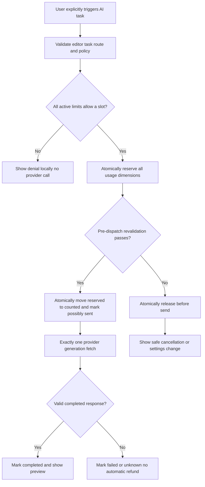

# Correctly V5.8 — Advanced Usage Limits, Quota Enforcement, and Notifications

**Document type:** Detailed implementation specification and acceptance-test plan for a coding agent  
**Milestone:** V5.8 only  
**Language:** English  
**Audience:** Coding agent working inside the existing Correctly V5 repository  
**Status:** Implementation instructions — NOT evidence that any feature has already been implemented or tested  
**Date:** 15 October 2026  
**Primary outcome:** The owner can configure reliable daily, weekly, and monthly **generation-request limits** (overall and by AI task), receives warnings at 80%, 95%, and 100%, and cannot accidentally bypass those local limits by opening multiple tabs, switching between Gemini and OpenAI, or restarting the browser.

> **AGENT — READ BEFORE TOUCHING CODE:** This is **V5.8**, not a new application. Extend the real V5.1–V5.7 extension and its established contracts. First audit the repository. Do not invent filenames or claim existing modules work when they have not been inspected. Build strict, fail-closed quota enforcement before polishing visual UI. Do not introduce a backend, Java, Python runtime, LanguageTool, telemetry server, cloud proxy, or additional paid LLM requests. **No request that an active limit denies may reach Gemini, OpenAI, or another provider.** Never describe locally enforced request limits as an absolute dollar ceiling.

---

## Table of contents

1. Non-negotiable decisions and scope
2. Dependencies and mandatory repository audit
3. Desired user experience and end-to-end stories
4. Terminology, accounting principles and formal invariants
5. Exact product rules: limits and task classification
6. Calendar windows, timezone and clock rules
7. Storage architecture and atomicity — the critical design decision
8. Data model and schema contracts
9. Request state machine and reservation algorithm
10. Simultaneous tabs, deduplication and crash recovery
11. Policy changes, deletion and migration
12. Notifications: 80%, 95%, 100% and deduplication
13. Settings page and popup UX
14. Minimal quota views, accessibility and localization
15. Provider/profile/model integration and cost distinction
16. Browser lifecycle, permissions and privacy
17. Exact implementation work packages
18. Unit and property-based tests
19. Integration, concurrency and crash tests
20. Manual test scenarios for Chrome and Brave
21. Adversarial tests and security controls
22. Troubleshooting and fixes
23. Performance and data retention
24. Documentation and release deliverables
25. Definition of Done and stop/go gates
26. Explicitly deferred V5.9 work
27. Final agent handoff checklist and report template
28. Official references and implementation caveats

---

## 1. Non-negotiable decisions and scope

### 1.1 Architectural decisions already made by the project owner

1. Correctly V5 is **personal-use** software, not a public hosted service.
2. Runtime is **browser-extension-only**: TypeScript, Manifest V3, background service worker, options/popup UI, and content scripts where applicable.
3. There is **no external Correctly backend**. No local Java server, Python service, Node service, EXE, or Windows installer should be added.
4. Gemini and OpenAI provider adapters, multiple user-entered API-key profiles, and task routing are introduced in V5.7.
5. AI requests occur **only on explicit user actions**. Text is never sent continuously merely because the user is typing.
6. V5.2 correction performs check + proposed correction within **one** model generation call, not an additional binary classification call.
7. V5.4 rewriting can request multiple tones in **one** generation call; selecting four styles must not be counted as four requests.
8. V5.5 translation and translate-and-rewrite may target different languages or dialects, including Syrian Arabic.
9. V5.6 custom text shortcuts remain **local, offline, and free**: they never increment AI counters or trigger model calls.
10. Existing previews, explicit Apply, Copy, Cancel, Undo, stale-editor guards, masking of protected shortcuts, and sensitive-field restrictions remain unchanged.
11. V5.1 has a **basic preliminary limit**. V5.8 upgrades it without weakening existing protections or erasing old usage.
12. V5.7 keeps profile IDs stable; **changing a key, provider, or model never resets the overall limit**.
13. V5.8 delivers usage **controls and warning/progress UI**, not the complete statistics/cost dashboard planned for V5.9.
14. Limits in this milestone count **AI generation attempts**, not input words, characters, style variants, API subscriptions, or monetary charges.
15. No raw API key, selected text, provider response, full prompt, or user's shortcut dictionary may be written into usage records.

### 1.2 Required functionality

| ID | Requirement | Required outcome |
|---|---|---|
| S-01 | Configurable daily generation caps | User can configure integer caps and see accurate remaining allowance |
| S-02 | Configurable weekly generation caps | ISO Monday-to-Sunday calendar week; explicit timezone |
| S-03 | Configurable monthly generation caps | Calendar month, not arbitrary 30-day rolling interval |
| S-04 | Separate task limits | Correction, Rewrite, Translation, Translate + Rewrite independently enforceable |
| S-05 | Overall limits | Every billable-capable model generation attempt consumes the appropriate global budget |
| S-06 | Optional provider/profile/model limits | Extra restrictive scopes; never replace or circumvent the global cap |
| S-07 | Alerts at 80%, 95%, and 100% | Exactly defined crossing rules; no repeated alert spam |
| S-08 | Hard local stop at 100% | No new generation call when any applicable cap is exhausted |
| S-09 | Atomic cross-tab enforcement | Concurrent requests cannot exceed a cap by racing on storage |
| S-10 | Safe crash/restart recovery | No automatic replay and no silently released possibly-billable attempts |
| S-11 | Durable, privacy-safe counters | Survive options reloads, service-worker suspension, browser restart, provider switching |
| S-12 | Clear settings and progress UI | Distinguish global/task/profile limits, upcoming reset, in-flight reservations |
| S-13 | Migration from prior V5 metadata | Preserve existing credentials, routes, shortcuts, and preliminary counts |
| S-14 | Exhaustive tests and evidence | Unit, integration, concurrent, migration, real-browser smoke tests |

### 1.3 Strictly outside V5.8

- Full historical graph dashboard, trend charts, exportable usage analytics, provider-cost comparisons: **V5.9**.
- New AI provider adapters or auto-switching to backup keys: not this milestone.
- LLM-powered budget prediction, token-only billing budgets, or online provider-balance synchronization.
- A paid API request to check how much quota is left.
- Automatic correction on every punctuation mark, keystroke, focus change or site navigation.
- Public accounts, login, cloud sync, remote usage storage, commercial billing infrastructure.
- Background polling of Gemini/OpenAI to discover provider-billing information.
- Support for unlimited arbitrary user-defined expressions or shell scripts in quota rules.
- Resetting historical usage by rotating a key, editing limits, or uninstall/reinstall tricks disguised as protection.

### 1.4 Essential truth about protection

**Local cap != guaranteed provider billing cap.** The extension can prevent *new API calls it controls*, but it cannot prevent:

- requests made through the same API key in a different app or browser profile;
- token-heavy requests that cost more despite low request count;
- charges already incurred before cancellation, timeout, or an offline response;
- deliberate removal/reinstallation/clearing of local storage or system-clock tampering;
- provider account charges, taxes, price changes and account-side usage;
- faults in the provider's own rate/quota system.

Settings must tell the owner to use **provider-side spending controls where supported** and to understand whether they are hard stops, warnings, or delayed billing estimates. Do not claim that all providers offer a hard monthly spending stop. Never silently create one using an undocumented API.

### 1.5 The key promise of this milestone

Given a **daily global cap of 5,000**, a **daily correction cap of 3,000**, and a **daily rewrite cap of 2,000**, the extension permits only requests admitted by **all applicable active caps**. At 80% and 95% it warns; at 100% it blocks new matching calls. That remains true across tabs, profiles, and models, as far as this extension's shared local storage can guarantee.

---

## 2. Dependencies and mandatory repository audit

**STOP: Do not implement from this document alone without inspecting the checked-out repository.** The V5.1 file is not guaranteed to be present in the agent's workspace, and planned behavior in earlier specifications is not proof of implemented behavior.

### 2.1 Minimum prerequisites

- [ ] V5.1: real Gemini connection and preliminary quota settings exist or gaps are documented.
- [ ] V5.2: correction orchestration reaches a central provider dispatcher.
- [ ] V5.3: keyboard, context-menu and smart-button triggers work through the same secure invocation flow.
- [ ] V5.4: rewrite supports multiple styles through one generation attempt.
- [ ] V5.5: translation / translate-and-rewrite have distinct task identities.
- [ ] V5.6: shortcuts and protected-token masking continue working offline.
- [ ] V5.7: Gemini/OpenAI provider routing, multiple credential profiles and a shared operation ledger are implemented or their gaps are explicitly documented.
- [ ] Actual typecheck, test, lint, build and browser test commands are identified from `package.json` and CI, not guessed.

### 2.2 Commands to run, adapted to the actual repository

```bash
pwd
git status --short --branch
git log -5 --oneline
ls -la
find . -maxdepth 3 -type f \( -name 'package.json' -o -name 'manifest.json' -o -name 'tsconfig.json' \) -print
rg -n "quota|limit|usage|reserve|attempt|provider|model|credential|shortcut|notification|storage|indexedDB" frontend docs . --glob '!node_modules/**' --glob '!dist/**'
```

If directory names differ, adapt. Do not do an expensive unbounded search across vendored dependencies, generated bundles or binary files.

### 2.3 Audit exactly these integration points

1. Identify the **single last safe point before any provider `fetch`**.
2. Find all calls that can generate tokens: correction, rewrite, translation, translate-and-rewrite, manual synthetic generation test, explicitly retried generation.
3. Find **metadata-only** calls: list models, API-key authentication checks that do not generate text.
4. Find where `operationId` is generated and where repeated UI events are deduplicated.
5. Find V5.1/V5.7 quota functions and exact existing count semantics.
6. Find what happens on `AbortController.abort()`, provider timeout, failed parse and HTTP error.
7. Find the existing storage layout and whether fields are in `chrome.storage.local`, IndexedDB, or other extension-origin storage.
8. Find existing versioned migrations and failure recovery logic.
9. Find how a credential profile is identified independently of label/key revision.
10. Find how notifications/messages reach settings, popup, content-script preview or toast.
11. Check whether `chrome.storage.local.setAccessLevel` is used to restrict secrets; never weaken it.
12. Check whether the extension currently asks for `notifications` permission; prefer in-app notices without new permission unless explicitly valuable.
13. Identify supported Chrome/Brave versions and real available APIs.
14. Capture a sanitized baseline of test output and current working behavior.

### 2.4 Produce an audit note before code modifications

Write `docs/V5.8_AUDIT.md` (or the repository's corresponding docs location) with:

- actual source locations of quota gate, dispatch, provider adapters, usage store, configuration store, UI and tests;
- actual existing V5.1 limit behavior, including what increments and what is refunded;
- whether V5.7 contains an operation ledger or only partial aggregates;
- current edge cases and migration hazards;
- chosen atomic persistence strategy and justification;
- tests that initially fail or are not runnable;
- any requested requirement impossible within the current supported browser environment.

**Do not quietly rewrite the architecture to hide prerequisite failures.** Report blockers, then perform only safe bounded remediation if the owner/agent operating instructions permit.

---

## 3. Desired user experience and end-to-end stories

### 3.1 First setup: conservative but usable

1. Owner opens Correctly settings.
2. Selects a new section, e.g. **Usage Limits**.
3. Sees an explanatory line: `These limits apply to API generation attempts made by Correctly on this browser profile. They do not guarantee a maximum API bill.`
4. Sees global Daily, Weekly, Monthly limit cards with an enable toggle and positive integer input each.
5. Can edit correction and rewrite limits separately in all three periods.
6. Can optionally configure translation and translate-and-rewrite separately, even if currently unused.
7. Sees a summary of all active limits and remaining requests, plus when the next relevant reset occurs.
8. Can enable or disable optional warning types (at least in-app alerts; browser notifications are opt-in if implemented).
9. Changes are applied with explicit Save; invalid values are blocked with clear messages.
10. Closing/reopening settings preserves valid configuration and usage. New settings do **not** clear prior counters.

### 3.2 Request below limits

1. Owner selects text in an ordinary website editor.
2. Uses V5.3 keyboard shortcut, right-click menu or smart-button.
3. Central background quota gate identifies `correction` or other requested task.
4. It checks the **global** caps, then task caps, then any enabled provider/profile/model caps.
5. Every cap passes; a durable reservation is created before provider dispatch.
6. Exactly one configured Gemini/OpenAI generation call proceeds.
7. Usage is counted according to the state-machine contract in Section 9.
8. Result appears in the existing preview, with Apply/Copy/Cancel/Undo behavior unchanged.
9. Usage progress refreshes without requiring the user to restart the browser.

### 3.3 Reaching 95% of a daily allowance

1. Owner sets a daily correction limit of `5,000`.
2. Correction usage reaches `4,750` counted attempts in the active day.
3. Correctly shows a **95% daily correction** warning once for that period.
4. Notice reads, for example: `You have used 4,750 of 5,000 correction requests today. 250 remain. Resets at midnight (Europe/Paris).`
5. Owner can dismiss it; it does not reappear for the same cap/period/threshold simply because settings were reopened.
6. Other enabled limits are still applied independently.
7. The next 250 matching operations may proceed, as long as no other applicable cap blocks them.
8. The next operation after the cap is reached is stopped **before** provider `fetch`.

### 3.4 Hitting several limits at once

- Suppose rewrite daily and overall monthly limits both block a request.
- The UI displays the **blocking reason(s)** without making multiple API calls.
- Highlight the most immediate constraint and offer `Open Usage Limits`.
- Do not silently change the provider/key/model to seek a free allowance.
- Do not claim the user's text was rewritten when no request was admitted.

### 3.5 Model switch or API-key rotation

1. Owner reaches a global cap on Gemini.
2. Owner selects an OpenAI key in V5.7 settings.
3. Existing **global** cap remains exhausted.
4. Rewriting/correction is still blocked as appropriate.
5. Per-credential limits, if configured, add restrictions; they never replenish global availability.

### 3.6 Local shortcuts

- Typing `bjr ` can still expand to `Bonjour ` through V5.6 even if all monthly AI limits are exhausted.
- No model call is sent, no quota slot is reserved, and no warning is generated merely for local expansion.

### 3.7 No network, error, cancellation or crash

- Rejected before send: reserved capacity can be safely released; usage shows no generated attempt.
- Provider request possibly sent and then fails: attempt remains counted to avoid an unsafe free retry.
- Browser/service worker restarts with ambiguous in-flight state: no automatic repeat; conservative accounting and clear recovery.
- No quota store access: AI call is blocked with `Cannot verify usage limits; no request was sent`.

---

## 4. Terminology, accounting principles and formal invariants

### 4.1 Vocabulary the agent must use consistently

| Term | Precise meaning |
|---|---|
| **Operation** | One explicit user intention: correct, rewrite, translate, combined task or generation test |
| **Generation attempt** | One call to a model generation endpoint, potentially chargeable |
| **Reservation** | A durable, temporary capacity claim made before the attempted network dispatch |
| **Possibly sent** | The extension has committed to dispatching or may have dispatched; count conservatively even after uncertain failure |
| **Counted usage** | A completed or possibly-sent attempt held against applicable request caps |
| **Success count** | A distinct informational metric; only valid successful model responses, not billing attempts |
| **Cap** | Maximum permitted counted-plus-reserved attempts for a scope/window |
| **Scope** | Global, task, provider, credential profile, or optionally model |
| **Window** | Calendar day, ISO calendar week, or calendar month in a configured timezone |
| **Threshold** | Warning level, 80%, 95%, 100% of enabled cap |
| **Provider limit** | Google/OpenAI's own external constraint — different from Correctly's local cap |

### 4.2 The fundamental counting rule

**Count one potentially billable generation attempt once.**

- One correction operation → **1** generation attempt.
- One rewrite requesting `Formal, Professional, Friendly, Funny` simultaneously → **1**, not 4.
- One translation → **1**.
- One combined translate + rewrite prompt sent as one generation → **1** in the `translate-and-rewrite` task category.
- One metadata-only key check/list-model call → **0 generation attempts** (but this is still a network request; no promise that providers never bill other endpoint usage).
- One deliberately confirmed synthetic **generation** test → **1** in `connection-test-generation`, subject to global and applicable profile/provider caps.
- One failed local validation, disabled site, sensitive field, blocked allowance, local shortcut, or cancelled-before-send → **0 counted attempts**.
- One possibly-sent timeout/HTTP error/cancel-after-send → **1 counted attempt**, with final billing status **unknown** if the provider does not prove it.
- One visible Retry after a possibly-sent previous attempt → potentially **another 1** if the user intentionally confirms that another generation call may cost money.

**Successful corrections in future V5.9 analytics are a separate statistic from generated attempt counts.** Show `Requests used`, not `Errors fixed`, in V5.8 quota bars.

### 4.3 Hard invariants (test each)

- **INV-01:** Any applicable exhausted cap blocks the request before provider dispatch.
- **INV-02:** A blocked request cannot increment a generation counter or contact a provider.
- **INV-03:** No code path reaches provider-generation transport without a valid central quota permit.
- **INV-04:** All applicable caps use the same logical operation ID and consume it no more than once.
- **INV-05:** For each cap, committed counted attempts plus active reservations can never exceed its max during admission.
- **INV-06:** No key/model/provider rotation resets or evades global budgets.
- **INV-07:** No local shortcut ever enters the AI quota accounting path.
- **INV-08:** Existing text preview and explicit-Apply safety remains untouched.
- **INV-09:** Last-millisecond concurrent requests cannot both consume the final slot.
- **INV-10:** Limits persist across service-worker suspension and browser restart.
- **INV-11:** A possibly-sent operation is not silently refunded on timeout, abort, crash or restart.
- **INV-12:** An operation cancelled unequivocally before send is safely released exactly once.
- **INV-13:** Warnings are deduplicated by scope, window, cap/threshold and policy generation, with clearly defined reset behavior.
- **INV-14:** A warning triggers only because of an actual threshold crossing or explicitly documented policy-change action.
- **INV-15:** Negative/NaN/fractional/unsafe-integer, malformed, expired or corrupted policy values cannot disable all checks accidentally.
- **INV-16:** No sensitive content or secrets are stored in usage/configuration/notification logs.
- **INV-17:** Storage unavailable or migration inconsistent → fail closed for AI operations.
- **INV-18:** No automatic paid retries, silent provider switching or sending of duplicate generations.
- **INV-19:** Time-window interpretation is deterministic and tested across DST, month and year boundaries.
- **INV-20:** User can understand why a request is blocked, which cap applies, and when that window is expected to reset.
- **INV-21:** V5.9 will be able to read minimal aggregated/ledger metadata without guessing historical token usage.
- **INV-22:** Limits do not claim to cap real USD billing; output-token variability is disclosed.

---

## 5. Exact product rules: limits and task classification

### 5.1 Base scopes required in the settings UI

**Global scopes (mandatory):**

- Global Daily cap
- Global Weekly cap
- Global Monthly cap

**Task-specific scopes (mandatory):** each individually has Daily, Weekly and Monthly controls:

- Correction
- Rewrite
- Translation
- Translate + Rewrite

**Additional optional advanced scopes:**

- Provider Daily/Weekly/Monthly: Gemini, OpenAI, etc., only from actually registered providers.
- Credential-profile Daily/Weekly/Monthly: stable V5.7 profile ID, not label or raw key.
- Model-specific caps (optional UX behind Advanced): only if routing/model IDs are sufficiently stable and the agent can implement complete coverage without breaking the mandatory scopes. If model caps are deferred, document them clearly rather than pretending they exist.

Every additional scope only **restricts**; it never creates extra allowance beyond global/task limits. Do not automatically create model-specific caps when the user adds a model.

### 5.2 Task key mapping — one source of truth

```ts
type QuotaTask =
  | 'correction'
  | 'rewrite'
  | 'translation'
  | 'translate-and-rewrite'
  | 'connection-test-generation';
```

Task labels in UI can be localized; stable internal IDs cannot be translated. Use V5.7's actual existing enum/union where possible; add a versioned mapping if it differs.

**Combined task must be unambiguous:** A single translate-and-rewrite operation consumes `global` + its `translate-and-rewrite` task cap, not separate translation and rewrite task caps by default. A later optional user setting for shared category grouping must not be silently introduced in V5.8. Explain this behavior in a tooltip and tests.

### 5.3 Cap input semantics

1. Each period row has `Enabled` and `Maximum requests`.
2. `Enabled = false` means that **particular cap** is not checked; all other caps remain checked.
3. An enabled cap requires a safe positive integer, `1..1,000,000` by initial UX policy; choose a documented max high enough for personal use without unsafe number behavior. If existing V5.1 supports larger safe values, preserve them or migrate explicitly.
4. Empty input is invalid while enabled. Never coerce empty to unlimited or zero.
5. Value `0` must not ambiguously mean unlimited. If the user wants zero AI generation, provide a separate `Pause all AI requests` switch with unequivocal wording.
6. Disabled cap retains its last valid value for convenient re-enabling; it does not erase recorded usage.
7. Changes to maximum are immediate after explicit Save and apply to the next admission decision.
8. Lowering a cap below current usage immediately blocks new requests; do not delete existing counts or hide that over-limit value.
9. Raising a cap may open capacity, but **previous threshold-warning history must not spam** (see Section 12).
10. There must be a documented safe initial state: preserve existing V5.1 basic limit(s), do not silently turn them off. On a truly fresh install, offer a conservative user-visible default, then allow the owner to modify it.
11. Do not silently count options-page opening, in-app navigation or statistics refresh as model attempts.
12. A synthetically generated model connection test consumes applicable caps; label this clearly before generating.

### 5.4 The 5,000-request example — exact boundary

With correction daily cap 5,000, global daily cap 10,000, and other caps unlimited/disabled:

- Usage 0: 5,000 correction attempts remaining.
- Usage 3,999: 79.98%, no 80% warning yet.
- Usage 4,000: 80% warning once.
- Usage 4,749: below 95%.
- Usage 4,750: 95% warning once.
- Usage 4,999: one matching correction permit remains.
- Request #5,000 is **allowed** and consumes the last permit.
- Once #5,000 counts, show `100% reached`; new matching corrections are blocked.
- Request #5,001 is denied before any provider fetch, independent of which API key is selected.

### 5.5 Caps interact by intersection, never addition

For operation `correction` routed through provider `gemini`, credential `profile-1`, model `model-x`, its admission must simultaneously satisfy:

- global daily, weekly, monthly (if enabled);
- correction daily, weekly, monthly (if enabled);
- Gemini provider daily, weekly, monthly (if enabled);
- `profile-1` daily, weekly, monthly (if enabled);
- model-specific limits, if explicitly implemented and enabled.

Remaining allowance = **minimum remaining among enabled applicable limits**, except where a cap is disabled (ignore it). If none is enabled, explicit safe default behavior from V5.1 is still required; do not accidentally create an unbounded paid path.

### 5.6 Disabled provider or deleted key

The quota gate does not override V5.7 credential validity. If a route becomes disabled, deleted or incompatible, deny the AI call **without** consuming a generation attempt. Never fall back to another paid route automatically. Deleting a profile must not erase historical totals in global/task scope. Retain past attribution to an opaque retired profile ID when needed for V5.9.

---

## 6. Calendar windows, timezone and clock rules

### 6.1 Use calendar periods, not rolling `now - N hours`

**Daily:** local midnight 00:00 inclusive to next local midnight exclusive.  
**Weekly:** Monday 00:00 inclusive through following Monday 00:00 exclusive (ISO week convention).  
**Monthly:** first day of month 00:00 inclusive through first day of next month exclusive.

The time zone must be explicit and user-visible. Use a valid IANA time zone such as `Europe/Paris` as detected via `Intl.DateTimeFormat().resolvedOptions().timeZone` on first setup (or migrate an existing owner preference). If detection is unavailable, choose a documented explicit fallback and notify the owner. **Do not infer timezone from country, IP address or calendar language.**

### 6.2 Timezone selection and changes

1. Store a chosen IANA timezone in quota policy, not just the system offset at installation time.
2. Default to browser-resolved timezone; let owner inspect it. Manual change is an advanced setting with an explicit confirmation.
3. Changing timezone must **not** grant a free reset or relabel prior usage silently. Choose and implement one conservative policy: keep existing usage in its original window IDs, and when switching, conservatively block overlapping period capacity until recalculated/reconciled, with an explicit migration report. Simpler acceptable implementation: postpone timezone change until the next global daily/weekly/monthly window boundary with clear UI; meanwhile keep original timezone.
4. If timezone setting becomes invalid/corrupted, deny model calls until repaired, rather than silently falling back to UTC and potentially bypassing limits.
5. Each window identity includes timezone and calendar start/end, not merely `new Date().getDate()`.

### 6.3 Correct handling of daylight saving time

A Paris calendar day can be 23 or 25 hours during DST transitions. Do not compute next midnight as `startUtc + 86_400_000`. Compute the next calendar boundary in the configured zone. Use established, tested date-time functionality or a carefully reviewed algorithm with fixtures; do not add a heavy runtime library without evidence it is needed.

### 6.4 Exact window identity suggestions

```ts
type Period = 'daily' | 'weekly' | 'monthly';

type WindowIdentity = {
  period: Period;
  timezone: string;                  // IANA e.g. Europe/Paris
  localStart: string;                // e.g. "2026-10-15" or Monday 2026-10-12
  startEpochMs: number;              // absolute UTC instant
  endEpochMs: number;                // exclusive absolute UTC instant
};
```

If ISO-week naming is used (`2026-W42`), compute the **ISO week year**, which can differ from the Gregorian year near New Year. Use a stable canonical key such as `period|zone|startEpochMs|endEpochMs`.

### 6.5 Browser clock changes

- A client-side-only system can be fooled by clock changes. Document this limitation.
- Persist the last seen real-clock timestamp and detect large backward jumps (choose a conservative threshold, e.g. >5 minutes, with tests).
- On suspicious backwards clock movement, **fail closed for new AI generations** until the user confirms a correction to their clock or a documented recovery condition is met. Do not destroy prior ledger entries.
- Moving forward should not discard still-live potentially sent operations or create duplicates; only valid new calendar windows become usable.
- Use injected clock abstraction for tests, not manual global Date monkey-patching across test suites.

### 6.6 Required calendar fixtures

- 2026-10-15 Europe/Paris: correct local day/week/month keys.
- Sunday 23:59:59 → Monday 00:00:00: new ISO week begins.
- Month end → day 1: new month begins.
- 2026-12-31 and 2027-01-01: ISO week-year rule verified.
- 2028-02-29: leap day.
- Paris spring DST transition: 23-hour day.
- Paris autumn DST transition: 25-hour day.
- Browser sleeping across midnight: no call is allowed on stale counters without recomputing window at actual dispatch.
- Timezone policy changed/invalid: no reset bypass.

---

## 7. Storage architecture and atomicity — the critical design decision

### 7.1 Why a naive `chrome.storage.local` counter is insufficient

The following is **unsafe** when two tabs or settings windows act concurrently:

```ts
const { used } = await chrome.storage.local.get('used');
if (used < limit) {
  await chrome.storage.local.set({ used: used + 1 });
  await callProvider();
}
```

Both callers can observe the same old value, both believe they own the last slot, and both send a paid API request. A service-worker in-memory `let count = ...` also vanishes when MV3 suspends or restarts. A promise queue alone is not durable when that process dies.

### 7.2 Recommended authoritative persistence

**Preferred solution:** use **IndexedDB inside the extension origin/service worker** for the *non-secret quota policy + journal + aggregate counter* state, with **atomic `readwrite` transactions** spanning the stores needed for an admission decision. Keep API secrets in the V5.7 isolated credential storage, not in IndexedDB usage records.

- Verify real Chrome/Brave support and test in actual Manifest V3 service worker.
- A single logical quota transaction checks all applicable caps **and** reserves all relevant capacity before completing successfully.
- A transaction must either commit all relevant quota counts/operation journal records or none.
- Use a stable schema version and transactional migrations.
- Do not perform `fetch`, long arbitrary awaited promises, UI events or other external asynchronous work inside a live IndexedDB transaction. Gather prerequisites first and keep transactional IDB operations tightly grouped.
- Implement unique `operationId` storage keys, transaction abort handling, and explicit failure states.
- Ensure browser/extension storage failure results in denied AI calls.
- Validate what the selected IndexedDB wrapper library actually guarantees; wrappers may hide transaction auto-commit pitfalls.

If the existing repository already contains a proven durable transactional quota store, adapt it rather than duplicating it. An alternative architecture is acceptable **only with tests proving equivalent atomic cross-tab, multi-period, post-crash behavior**. `chrome.storage.local` read/modify/write + in-memory lock is not by itself an acceptable equivalence proof.

### 7.3 Suggested stores

| Store | Key | Purpose | Sensitive text allowed? |
|---|---|---|---|
| `quotaPolicies` | `active` | Versioned active policy, timezone, limits, revision | No |
| `quotaCounters` | Scope + period + window identity | Counted/reserved usage for fast guard | No |
| `quotaOperations` | Stable operation ID | Idempotency, route attribution, state, timestamps | No |
| `quotaAlertOutbox` | Stable notification key | Threshold dedup and pending alert delivery | No |
| `quotaMigration` | Migration ID/version | Legacy data mapping and repair marker | No |

Storing whole prompt/text in any of these stores is strictly prohibited.

### 7.4 Aggregate counters vs operation journal

- Aggregate counters are the low-latency source for read-only progress summaries **only if** they can be reconciled with the operation journal.
- Every reservation/dispatch/settlement changes operation state exactly once.
- Avoid an unbounded permanent journal. Retain a bounded recent journal spanning all active windows plus sufficient recovery horizon; archive or aggregate older metadata safely. Do not delete data still needed for weekly/monthly caps or unresolved possibly-sent attempts.
- Historical totals older than the largest quota window can remain aggregated for V5.9; avoid claiming precise old-day analytics where no data exists.
- On schema mismatch, corruption, partial migration, stale/unknown operation or transaction abort, do not silently reset counts to zero.

### 7.5 Atomic transactions in a nutshell

**Admit:** within one `readwrite` transaction over all relevant stores:

1. Read active policy + revision.
2. Derive effective applicable cap keys from immutable operation route/task/time.
3. Read each required counter.
4. Reject immediately if any `counted + reserved >= cap`.
5. Verify operation ID is not already owned by a conflicting request.
6. Increment **reserved** once for each applicable cap key.
7. Add durable operation record with state `reserved`, policy revision and exact reservation keys.
8. Commit transaction; only then may a call advance toward dispatch.

**Mark possibly-sent:** within an atomic transaction, update all reservation keys from `reserved` to `counted`, mark `dispatching/possibly-sent`, persist timestamp/snapshot, and enqueue any thresholds crossed. **Only after successful commit** initiate provider fetch.

**Rollback before sending:** atomically decrement reservations, move operation to `cancelled-before-send` or `failed-before-send`, never below zero.

**Settle after sending:** mark `completed`, `failed-after-send`, `cancelled-after-send`, or `unknown`; do **not** refund counted slots just because the reply failed.

### 7.6 Check admission against all windows and scopes

A single correction can affect 3 global windows, 3 correction windows, plus optional provider/profile/model windows. It is *one* operation, not one per counter. There must be no state where global monthly is incremented but task daily was not. Never commit separate independent storage writes and claim the result is atomic.

### 7.7 IndexedDB opening, upgrades and blockers

- Register `onupgradeneeded`, `onblocked` and `versionchange` handling, with clear UI fallback.
- Close obsolete DB connections on version change to let the new version open.
- Use deterministic indexes, documented store names and meaningful schema version.
- Test failed upgrades, corrupt records, old browser profile migration, storage pressure and blocked IDB access.
- Avoid adding `unlimitedStorage` permission reflexively; justify any new permission and test its effect.
- Do not use IDB in content scripts to authorize generation; privileged worker owns admission and dispatch.

---
## 8. Data model and schema contracts

> **These TypeScript types are design examples, not permission to replace working V5.7 types blindly.** Inspect and adapt to the real repository. Prefer small, composable, strongly typed modules under TypeScript `strict`.

### 8.1 Policy model

```ts
type QuotaPeriod = 'daily' | 'weekly' | 'monthly';
type QuotaScopeKind = 'global' | 'task' | 'provider' | 'credential' | 'model';

type CapSetting = Readonly<{
  enabled: boolean;
  maxAttempts: number; // validated positive safe integer if enabled
}>;

type PeriodCaps = Readonly<Record<QuotaPeriod, CapSetting>>;

type TaskId =
  | 'correction'
  | 'rewrite'
  | 'translation'
  | 'translate-and-rewrite'
  | 'connection-test-generation';

type QuotaPolicyV8 = Readonly<{
  schemaVersion: 8;
  revision: number;
  timezone: string; // validated IANA identifier
  global: PeriodCaps;
  tasks: Partial<Record<TaskId, PeriodCaps>>;
  providers: Readonly<Record<string, PeriodCaps>>;
  credentials: Readonly<Record<string, PeriodCaps>>;
  models?: Readonly<Record<string, PeriodCaps>>; // only if implemented completely
  pauseAllAi: boolean;
  alerts: {
    inApp: boolean;
    browserNotifications: boolean;
    thresholds: readonly [80, 95, 100] | readonly number[];
  };
  updatedAt: string;
}>;
```

If browser-native alerts are not implemented or permission is denied, `browserNotifications=false`; in-app warnings must still work. Store only known task/provider IDs and validate fields strictly.

### 8.2 Identity and aggregation keys

```ts
type QuotaDimension = Readonly<{
  kind: QuotaScopeKind;
  id: string; // global, task kind, provider ID, stable profile ID, model route ID
}>;

type QuotaCounterKey = Readonly<{
  dimension: QuotaDimension;
  period: QuotaPeriod;
  windowStartMs: number;
  windowEndMs: number;
  timezone: string;
}>;

type QuotaCounterValue = {
  counted: number;
  reserved: number;
  successful: number; // separate informational metric, not part of admission
  updatedAtMs: number;
};
```

A model identity should be `providerId + exact documented modelId`, and must never include a secret or mutable profile label. Use stable credential IDs, not the API key string, to attribute usage. Validate IDs and prevent hostile storage keys from causing collisions.

### 8.3 Crucial rule: account for usage even when a cap is disabled

**Do not only update enabled caps.** If a cap is disabled for part of a month and later enabled, the owner should not accidentally start with false zero usage for that month.

For every generation attempt, maintain aggregate usage for the **canonical global, task, provider and credential dimensions** in each day/week/month, even if the corresponding cap is disabled. If optional model caps are supported, maintain model dimensions too. During admission, check only enabled limits, but reserve/update accounting keys for all these dimensions. The transaction must remain atomic and bounded.

For a newly created key profile, usage prior to that profile's existence is naturally zero for the profile-only scope. The overall and task counters continue unaffected. Usage attribution missing from legacy data must be marked as unknown, never guessed.

### 8.4 Operation record

```ts
type QuotaOperationState =
  | 'reserved'
  | 'dispatching' // possibly sent; count conservatively
  | 'completed'
  | 'failed-before-send'
  | 'failed-after-send'
  | 'cancelled-before-send'
  | 'cancelled-after-send'
  | 'unknown';

type QuotaOperationV8 = {
  id: string;                  // random operation ID from privileged dispatcher
  task: TaskId;
  providerId: string;
  credentialId: string;
  credentialRevision: number;
  modelId: string;
  state: QuotaOperationState;
  createdAtMs: number;
  dispatchAtMs?: number;
  settledAtMs?: number;
  policyRevision: number;
  reservedCounterKeys: readonly string[];
  countedCounterKeys: readonly string[];
  sendCount: 0 | 1;
  responseStatus?: 'ok' | 'http-error' | 'timeout' | 'network-error' | 'refused' | 'invalid-output';
  tokenUsage?: {
    inputTokens?: number;
    outputTokens?: number;
    totalTokens?: number;
    reasoningTokens?: number;
    available: boolean;
    source: 'provider' | 'not_available';
  };
  usageOrigin: 'normal' | 'generation-test' | 'legacy';
};
```

Actual object shape may change as long as every safety property is demonstrably preserved. `sendCount` is a locally recorded intent, not proof a provider received or billed the request. Never persist selected text, model response text, prompts, API headers or keys. Use validated small operation IDs and capped metadata field lengths.

### 8.5 Result contracts

```ts
type QuotaDenied = {
  allowed: false;
  reason:
    | 'cap-exhausted'
    | 'ai-paused'
    | 'invalid-policy'
    | 'storage-unavailable'
    | 'clock-anomaly'
    | 'route-invalid'
    | 'operation-duplicate';
  blocking: readonly {
    dimension: QuotaDimension;
    period: QuotaPeriod;
    max: number;
    used: number;
    reserved: number;
    resetAtMs: number;
  }[];
};

type QuotaAdmitted = {
  allowed: true;
  operationId: string;
  reservationToken: string; // opaque and private to trusted worker; not browser tab/page
  policyRevision: number;
};

type QuotaAdmission = QuotaDenied | QuotaAdmitted;
```

**No raw permit secret or internal ledger modification method is exposed to content scripts.** The service worker should return only sanitized status summaries where needed for user-facing UI.

### 8.6 Validation and defaults

- Parse persisted policy using an explicit runtime schema validator or fully tested manual validation; TypeScript compile-time checks cannot validate browser storage.
- Reject object prototypes, arrays in place of maps, unsafe integers, unknown enum strings, negative counters, impossible timestamps and invalid timezone values.
- Do not log the raw corrupted record if it might contain unexpected secrets.
- Distinguish `missing policy` on truly fresh install from `existing but invalid policy`. Only the former may receive documented default initialization.
- A failed migration cannot silently create default empty counters.
- Freeze or clone immutable snapshots so settings edits do not mutate an in-flight operation.
- Do not trust caller-provided `providerId`, `modelId` or `operationId` unless matched to the actual resolved background route and dispatch state.

---

## 9. Request state machine and reservation algorithm

### 9.1 State transition diagram



**Important:** The Mermaid flowchart explains conceptual control flow. Actual code must use transactions, immutable operation IDs, and robust error handling; no promise that network dispatch can be made atomic with the provider's server.

### 9.2 Preflight order

1. Verify a real user-triggered operation exists.
2. Reject sensitive/uneditable/unsupported selection using prior V5.2–V5.7 safeguards.
3. Validate type of task and nonempty effective input.
4. Deduplicate overlapping trigger paths before any provider call.
5. Resolve provider, credential profile, revision and model exactly once via V5.7 route logic.
6. Check provider and model capability, credential enabled state and any pause/disable policy.
7. Read/validate quota policy with a trusted service-worker function.
8. Obtain an immutable operation snapshot (IDs, task, route, expected editor reference).
9. Atomically check and reserve all relevant dimensions/windows.
10. If denied, return sanitized denial immediately; never construct a provider request with an active credential.
11. Prepare prompt/protected text using existing V5.6 logic, never exposing secrets to UI/page.
12. Recheck current route/status/policy and calendar windows immediately before dispatch; recompute a safe reservation when necessary.
13. Atomically mark the operation **possibly sent** and move reserved→counted usage.
14. Only now call the chosen provider adapter **once**.
15. Parse and validate response through existing task-specific contract, then settle state.
16. Preview only safe validated result; editor content changes exclusively after user Apply.

### 9.3 Reservation semantics and collision handling

- A fresh operation has a cryptographically random ID created in trusted extension context.
- Repeating `admit` for the same operation ID and matching snapshot is idempotent: return its existing valid state or reject duplicate as appropriate; never increment twice.
- Repeating with same ID but different task/route is an integrity error; reject.
- If two independent operations compete for one slot, only one can commit an eligible reservation; the other must read updated state and fail.
- Reserve before prompt construction if it avoids unwanted work, but do not call provider until after final revalidation.
- Reserve all canonical accounting dimensions even when a particular limit toggle is off (Section 8.3).
- Guard against stale reservations from a crashed process; see Section 10.

### 9.4 Revalidation just before send

Check:

- same operation ID and still reserved state;
- route profile enabled, profile credential revision unchanged, model still selected and capable;
- quota policy not changed in a way that invalidates reservation;
- no new `pause all` switch;
- clock/window identity has not moved into a new day/week/month;
- original editor operation has not been cancelled before send;
- no explicitly known browser state prevents a safe request.

If active policy changes, perform a **transactional policy-revision revalidation**, not an uncoordinated check after capacity has been granted. When stricter policy now blocks, release before send and deny. If the window rolled over, move the pending reservation atomically from old windows to appropriate new windows, then repeat cap checks. Count the eventual attempt in the calendar window of the committed dispatch moment, not blindly in the old reservation window.

### 9.5 Commit before `fetch`, acknowledge unavoidable uncertainty

A browser cannot atomically commit its local database and send an HTTP request to a remote provider. There is an unavoidable crash gap:

1. mark possibly sent + count locally;
2. service worker might crash **before** `fetch` actually transmits.

Choose the **conservative** policy: such an operation is still counted. This can very occasionally underutilize the owner's allowance, but it avoids granting unsafe free retries after a potentially billable request. Document this honestly and test the no-auto-retry invariant.

### 9.6 Settlement and status mapping

| Event | State | Counts against cap? | Auto retry? |
|---|---|---|---|
| Admission rejected | Denied, no record needed | No | No |
| Cancel/invalid before dispatch | `cancelled-before-send` | No, safe release | No |
| Credential disabled before send | `failed-before-send` | No, safe release | No |
| Successful provider response | `completed` | Yes | No |
| Provider 401/403/429/5xx after dispatch | `failed-after-send` | Yes, conservatively | No |
| Network timeout after dispatch | `unknown` | Yes | No |
| User cancels after dispatch | `cancelled-after-send` | Yes | No |
| Worker disappears after dispatch | `unknown` on recovery | Yes | No |
| Malformed/refused generated output | `failed-after-send` | Yes | No |
| User clicks Retry and confirms | New operation ID | New counted attempt if sent | Explicit only |

A transport error before the dispatch-commit step must not be misclassified as a sent attempt. An explicit HTTP error after dispatch can have uncertain billing; do not equate `counted` with an invoice charge.

### 9.7 No double counting on preview/Apply/Copy/Cancel

- Rendering a preview costs zero additional model requests.
- Clicking Apply costs zero additional model requests.
- Clicking Copy costs zero additional model requests.
- Clicking Cancel after a response costs zero additional model requests and must not remove the already-counted attempt.
- Clicking Undo costs zero additional model requests.
- Asking the LLM again to improve a result is a **new user-triggered generation** and must pass quota gates as a new attempt.

---

## 10. Simultaneous tabs, deduplication and crash recovery

### 10.1 Mandatory concurrency design

- There is a single privileged generation gateway in the V5 background architecture.
- Every calling surface (shortcut/context menu/button/options generation-test) uses the same quota-gated entrypoint.
- IndexedDB atomic transactions serialize conflicting readwrite sets; every competing request re-reads committed counts.
- Each operation must have a stable deduplication key/ID that does not accidentally identify different user intentions as duplicates.
- A front-end debounce is for UX only. It is **never** the authoritative financial guard.
- Do not expose a direct provider-client method to content scripts that bypasses `admit`/`dispatch`.

### 10.2 Deduplicating trigger races

Scenario: the same selected sentence is triggered through keyboard + right-click within milliseconds. Preferred behavior:

1. A per-editor/action in-flight guard in privileged orchestration identifies overlapping intended invocations.
2. One request is admitted; the other is suppressed or receives `Already processing`.
3. Exactly one model generation call goes out.
4. After explicit completion, a genuinely new user action can create a new operation ID and must pass limits again.
5. Different tabs editing different texts may each request independently as long as aggregate caps permit.

Do not treat different user texts as duplicates based solely on string equality; two identical sentences in different contexts can be legitimate separate actions.

### 10.3 Service-worker suspend/restart

- On service-worker wake/start, initialize the trusted DB facade lazily and validate schema before serving generation messages.
- No automatic replay of `reserved`, `dispatching` or `unknown` operations.
- Stale **reserved** operations whose send has definitely not begun can eventually be released by a bounded, idempotent recovery operation after proving `dispatching` was not committed. A hard timeout alone is insufficient if the code could have sent before persisting dispatch; the design must persist dispatch intent first.
- `dispatching` survives as counted; after process death classify as `unknown` with no refund.
- If recovery itself fails, block new generations until reconciliation succeeds.
- Do not rely on `setTimeout` or continuous in-memory intervals for correctness. Reconcile lazily on invocation and settings open. Optional `chrome.alarms` may assist cleanup but cannot be the only protection.

### 10.4 Multi-tab test with one slot

- Configure global daily maximum = 1 (and all other limits high enough).
- Open 20 independent editor tabs or mocked parallel trusted requests.
- Fire at least 20 generation requests simultaneously with distinct operation IDs.
- Assert **one** transaction gets a permit and 19 are denied.
- Assert provider spy observes **one** generation call.
- Assert counter is 1, reserved eventually 0, no negative values.
- Restart the extension service worker; repeat, expect all new calls blocked until reset.

### 10.5 Same operation ID replay

- Request #1 reserves, gets sent and settles.
- Simulate duplicate message delivery of its exact same ID.
- Second message must return a safe already-seen or duplicate status; not send, not count twice.
- Repeat this test after browser restart, not only in same in-memory process.

### 10.6 App/browser profile boundaries

- Chrome and Brave generally use **separate extension profile storage**. Their local quotas do not coordinate across browsers without a backend.
- Multiple Chrome profiles, devices, and Incognito configurations may have separate storage too.
- UI must say `Limits apply to this browser profile` rather than claiming a global account-wide restriction.
- Do not add an external sync service to solve cross-browser caps; explicitly document this limitation.

---

## 11. Policy changes, deletion and migration

### 11.1 Editing a policy while requests are running

1. Settings page loads current versioned policy, revision `N`.
2. User edits form locally; typed values are not active until validated and saved.
3. Save is one transactional update guarded by policy revision (compare expected `N`).
4. If another settings window saved revision `N+1`, current save must fail with `Settings changed elsewhere. Reload or review differences`; do not silently overwrite.
5. After Save, **new** requests use revision `N+1`.
6. Reserved but unsent operations must be revalidated against the new policy before dispatch.
7. Possibly-sent requests keep immutable route/time attribution; later settings edits do not retroactively refund them.
8. A policy reduction below usage shows `X of Y used; requests blocked` rather than truncating `X`.

### 11.2 Turning a cap off and on

- Turning a cap off does not delete its usage history.
- All canonical counters keep tracking even while the cap toggle is disabled.
- Turning it on again mid-window enforces the complete usage already recorded during that window.
- Turning on an extremely low cap does not retroactively cancel a network request already dispatched.
- If warning thresholds were crossed while disabled, no retroactive toast storm; display current state in settings and if newly enabled limit is already exhausted, show one contextual blocked-state message.

### 11.3 No deceptive `Reset counters` button

- Do **not** add a normal Reset Usage button that simply clears counts and allows billable traffic anew.
- If a diagnostics-only database-repair action is ever necessary, require explicit backup/reconciliation and treat it as advanced manual recovery; do not present it as a quota bypass.
- Alerts can be dismissed or local display preferences reset without resetting the true usage ledger.

### 11.4 Migration inventory

Inspect actual V5.1 and V5.7 stores first. Possible legacy data includes:

- one Gemini API key and basic daily limit;
- existing operation counts that may not be task-classified;
- V5.7 provider/profile/model metadata, operation IDs and token usage;
- previous attempts already reserved/sent/failed;
- settings/version fields and shortcut lists.

Do **not** assume timestamps or per-task attribution exist when legacy schema lacks them.

### 11.5 Migration rules

1. Read old schema with strict validation and create a **backup or repair journal marker without secrets**.
2. Do not rewrite or clear the credentials namespace.
3. Preserve V5.1 basic guard semantics with an explicit equivalent mapped policy; if unknown, keep old guard active as an additional safety check until verified migration.
4. Copy valid, attributable records into new stores transactionally where supported.
5. When old global aggregate counts have unknown task/date breakdown, retain them as `legacy-unattributed`; do not assign them to arbitrary periods or task types.
6. Choose a conservative first-period guard if the legacy aggregate might include current usage: do not silently grant full fresh allowance. If exact reconciliation is impossible, show a clear migration warning and require deliberate owner confirmation to use an explicitly documented approach.
7. New counters must never overwrite valid old counters on each extension start.
8. Use an idempotent migration ID and schema version. If migration crashes halfway, restart safely without double-import.
9. No automatic generation call is allowed during migration.
10. Test browser reload, upgrade from at least two legacy shapes, missing ledger, partial data corruption, and disabled API profile.

### 11.6 Protected settings

Any extension upgrade must preserve: provider credentials; credential labels/IDs; correction/rewrite/translation routes; preferred languages and Syrian dialect; rewrite style choices; shortcut expansions; site exclusions; protection masks; editor preferences; previously selected keyboard/context-menu preferences; existing usage metadata.

### 11.7 Retention and uninstall caveat

Browser extension local data may be erased by uninstalling, clearing profile data or using another browser. No frontend-only design can guarantee that counters survive deliberate local data deletion. State this honestly in documentation. For retained data, keep enough day/week/month accounting to enforce any active cap and enough aggregate data for V5.9, without storing user text.

---

## 12. Notifications: 80%, 95%, 100% and deduplication

### 12.1 Required thresholds and defaults

- **80%:** informational advance warning; optional display toggle may be supported; default enabled unless existing UX conventions strongly suggest otherwise.
- **95%:** stronger advance warning, enabled by default.
- **100%:** cap reached, no remaining capacity; **always visible as blocking status** even if transient notifications are dismissed.
- Percent calculations must use integers to avoid floating-point boundary bugs:

```ts
function reached(used: number, maximum: number, percent: 80 | 95 | 100): boolean {
  // With max <= 1,000,000 the multiplication is safe as integer.
  return used * 100 >= maximum * percent;
}
```

For another maximum range, guard integer overflow and use safe integer arithmetic or a tested rational method.

### 12.2 Threshold crossing rule

An alert is newly eligible when `previousUsed < ceil(limit * threshold / 100)` and `newUsed >= ceil(limit * threshold / 100)` for an **enabled** cap in that window. For example 95% of 5,000 is 4,750. Compute the threshold with integer-safe math.

- Trigger alerts when attempts become counted (possibly-sent), **not merely reserved**.
- Do not show `You have used...` for an unsent reservation that later rolls back.
- When a multi-step jump crosses both 80 and 95 due to migration/policy change, do not emit a cascade of duplicate toasts. Prefer one highest-severity appropriate notice, with current progress. Document precisely how dismissed lower thresholds are recorded.
- With small caps (`1`, `2`, `3`), multiple thresholds may be met by the same attempt; **emit only the highest crossed severity** in a single event, but record the lower thresholds as satisfied to avoid later spam.
- If multiple scopes cross simultaneously, group them into one human-readable notification, prioritizing the most restrictive cap. Display all blocking scopes in settings.
- A denied request at an exhausted cap displays an actionable blocking message even if the original 100% toast was dismissed.

### 12.3 Deduplication identity

Conceptual ID:

```
quota-alert|policy-family|scope-kind|scope-id|period|window-start|threshold
```

Use sanitized stable IDs. `policy-family` must not reset on every minor edit and cause duplicate 95% warnings; revision changes alone should not reshow alerts. Rules for editing thresholds should be explicit and tested. A new calendar window naturally creates a fresh identity; profile label renaming does not.

### 12.4 Delivery pipeline

1. During atomic dispatch-count transaction, detect threshold crossings for active caps.
2. Record stable pending alert data in `quotaAlertOutbox` without text/keys/prompts.
3. Commit. Never show a claim about a counted attempt before the commit exists.
4. After commit, a trusted notification dispatcher translates sanitized metadata to localized in-app messages.
5. Mark delivered or attempted using stable alert identity. Deal intentionally with crash between send and marking (idempotent browser notification ID, or at-most-once UI queue with documented possible missed toast).
6. If alerts permission is absent, keep in-app settings warnings and toolbar/popup indicators.
7. On restart, retry a bounded set of undelivered *current-window* notices without spamming already dismissed alerts.

### 12.5 Notification surfaces and permissions

**Mandatory:** settings/popup inline progress warning, and an in-extension notice/toast when Correctly's UI is open for the current action. A content-script toast is optional and must not reveal text, route secrets or trusted objects to the page.

**Optional, opt-in:** native Chrome/Brave browser notifications, via `chrome.notifications` with documented permission support and safe localized message. Do not add a new broad permission or request it without a justified UX and manual tests. For native notification support, use feature detection, explicit user opt-in, stable IDs, rate limiting, icon availability checks and a graceful fallback when permission is denied. No background polling is needed to discover thresholds: events are driven by usage.

### 12.6 UX copy examples — no misleading billing claims

- 80%: `Correctly: 80% of your daily correction request limit used (4,000 / 5,000).`
- 95%: `Correctly: 95% of your daily correction limit used (4,750 / 5,000). Only 250 remain.`
- 100%: `Daily correction request limit reached (5,000 / 5,000). New AI corrections are blocked until the next daily reset or an explicit settings change.`
- Weekly cap: `Weekly total AI request limit reached. Resets Monday at 00:00 (Europe/Paris).`
- Monthly cap: `Monthly rewrite request limit reached. Resets on the first day of next month at 00:00 (Europe/Paris).`
- Storage failure: `Correctly cannot verify your usage limits right now. No AI request was sent.`
- Unsupported notification permission: `Browser notifications are unavailable; usage warnings remain visible inside Correctly.`

### 12.7 Notification navigation

- `View limits` opens the trusted extension settings page on the Usage Limits section.
- If native notifications provide click actions, map only a known notification ID to that extension-owned page. Never navigate to a URL supplied by a website or provider response.
- Closing the warning never changes the enabled cap and never authorizes one extra request.
- Screen reader users should receive announcements that are polite at 80%, assertive for block/100%, without a repeating live-region loop.

### 12.8 Exact alert fixtures

| Max | Previous → new | Expected |
|---:|---|---|
| 5,000 | 3,999 → 4,000 | One 80% warning |
| 5,000 | 4,749 → 4,750 | One 95% warning |
| 5,000 | 4,999 → 5,000 | One 100% reached status |
| 5,000 | 5,000 → blocked | Denial; no extra attempt |
| 1 | 0 → 1 | One 100% notice, not 3 separate alerts |
| 2 | 0 → 1 | 50%, no 80/95 warning |
| 2 | 1 → 2 | One 100% notice |
| 10 | 7 → 8 | One 80% notice |
| 10 | 9 → 10 | One 100% notice (95 crossed too; grouped) |

---

## 13. Settings page and popup UX

### 13.1 Information architecture

Preferred settings navigation:

```
Correctly Settings
  ├── AI Providers & API Keys          (V5.7; unchanged)
  ├── AI Task Preferences              (V5.2–V5.5; unchanged)
  ├── Personal Shortcuts               (V5.6; unchanged)
  ├── Usage Limits                     (V5.8; NEW)
  │     ├── Overview / current allowance
  │     ├── Global limits
  │     ├── Correction limits
  │     ├── Rewriting limits
  │     ├── Translation limits
  │     ├── Translation + rewriting limits
  │     ├── Advanced provider/key limits (optional)
  │     ├── Warnings and browser notifications
  │     └── Timezone and help
  └── Usage Statistics                 (V5.9; do not build yet)
```

Follow the existing V5 options design system. Do not create an independent full-screen app or reimplement preferences infrastructure needlessly.

### 13.2 Global limit controls

Each global card shows:

- `Daily`, `Weekly`, `Monthly` rows;
- On/off toggle with accessible label;
- numeric input with unit `AI requests`;
- current `used / cap` and `remaining`;
- percent and progress bar (with text, not color alone);
- expected reset instant with timezone;
- status `Available`, `Approaching limit`, `Limit reached`, `Disabled`, or `Unknown: storage unavailable`;
- helper text that provider switching cannot bypass the cap.

### 13.3 Task limit cards

- Separate correction, rewrite, translation, translate + rewrite cards.
- Display the same daily/weekly/monthly rows and count semantics.
- Give users a concise explanation: `One rewrite operation counts as one request even when it returns multiple style options.`
- Explain the combined-task category once: `Translate + Rewrite counts once in its own category.`
- If a limit is disabled, show `Off (still tracking usage)` rather than `0 used`.
- Do not show successful rewrite count as if it were API request count.

### 13.4 Editing and validation UX

1. Settings load safely, with skeleton/disabled Save while storage initializes.
2. All current values are clearly visible and editable by keyboard.
3. Each numerical field uses appropriate locale-friendly input processing, but persists a canonical integer; do not mistake `5,000` (English grouping) for `5` or parse `5 000` unsafely.
4. Avoid silently accepting scientific notation, decimals, negative values, huge unsafe integers or blank fields.
5. Save disabled until form is valid and changed.
6. On Save, write one versioned policy transaction; show success only after committed.
7. On concurrent edit conflict, show reload/review actions.
8. On storage failure, retain unsaved form state and explain failure; do not display fake success.
9. A newly enabled cap below current usage warns **before Save**, then clearly shows blocked state after Save.
10. `Pause all AI` requires an explicit interaction; keep local shortcuts operational.
11. `Reset notifications` if offered may clear dismissed UI state only, not usage/cap records.
12. Destructive disable or cap changes do not implicitly clear API keys, text preferences or shortcuts.

### 13.5 Minimal popup glance view

- One concise summary: `AI requests today: 42 / 100 (58 left)` if a daily global cap is enabled.
- If global daily disabled, show the nearest active applicable global cap or `No global daily cap — local usage still tracked`.
- Optional per-task summary for correction and rewrite, without a full V5.9 historical chart.
- If any hard limit blocks the currently chosen task, show a clear badge/text and a `Manage limits` link.
- Never show raw keys in the popup or append text of the user's selection to alert content.

### 13.6 Example settings state

```text
USAGE LIMITS
Timezone: Europe/Paris

TOTAL AI REQUESTS
Daily      [On]   100          Used 82 / 100        18 remaining
Weekly     [On]   500          Used 230 / 500       270 remaining
Monthly    [On]   2,000        Used 940 / 2,000     1,060 remaining

CORRECTION
Daily      [On]    60          Used 51 / 60         9 remaining
Weekly     [On]   300          Used 145 / 300      155 remaining
Monthly    [On] 1,200          Used 602 / 1,200    598 remaining

REWRITE
Daily      [On]    30          Used 23 / 30         7 remaining
Weekly     [On]   150          Used 72 / 150        78 remaining
Monthly    [On]   500          Used 242 / 500      258 remaining

WARNINGS
[x] Inside Correctly
[x] At 80%
[x] At 95%
[always] At 100%, AI requests are blocked
[ ] System browser notifications (optional)
```

This is **illustrative test data only**, not an actual account state and not a provider quote.

---

## 14. Minimal quota views, accessibility and localization

### 14.1 Accessible progress

- Render semantic labels or accessible equivalents for each progress bar (`Correction daily usage: 95 percent, 4,750 of 5,000`).
- Do not rely on green/yellow/red alone; use text status and distinct icons when helpful.
- Respect `prefers-reduced-motion`; avoid flashing animations at limit reached.
- Alert dialogs must not steal the input editor focus when user is typing, or leave text selection corrupted.
- Focus trap only for real modal dialogs; toast dismissal and keyboard activation must work.
- Screen-reader live-region messages are throttled and deduplicated to prevent repeated announcements.
- Make small number fields accessible at high browser zoom and narrow settings viewports.

### 14.2 Localization

- Follow the existing extension UI language setting (French/English). If localization for Arabic is not already part of the UI, do not silently turn the whole extension Arabic in V5.8.
- Localize cap names, task names, warnings, reset text, buttons, and error messages using the existing translation approach.
- Preserve internal IDs (`correction`, `weekly`, `providerId`) independently of displayed language.
- For `Europe/Paris`, format `Monday 00:00` in a locale-appropriate way and display time zone; verify DST reset time.
- Correctly format thousands and decimalless integer input. Do not mix UI string formatting with persisted numeric values.

### 14.3 Progress calculations

- `percentage = min(100, 100 * counted / max)` for visual fill; when cap is lowered below usage, show `Used 120 of 100 (over limit)` in text, not hide overage.
- Reserved pending requests should be visible as `In progress: N`, or at minimum included transparently in `remaining now`. If the user is at 9 counted + 1 reserved with cap 10, **remaining available now is 0**, not 1.
- UI should not show false confidence when it cannot access storage. Prefer `Usage temporarily unavailable` rather than `0 / max`.
- `Reset at` is based on the configured calendar timezone and current active window, not approximated by `24h after first use`.

---

## 15. Provider/profile/model integration and cost distinction

### 15.1 Central provider routing integration

The V5.7 task dispatcher may select:

- correction → OpenAI model A, profile `openai-primary`;
- rewrite → Gemini model B, profile `gemini-main`;
- translation → Gemini or OpenAI, depending on preference;
- combined translate+rewrite → route defined by V5.7 rules.

Each request must carry a **trusted immutable route snapshot** to the quota engine. A caller-supplied arbitrary profile ID must not be used to escape a profile cap. Preserve V5.7 explicit routing behavior; no fallback to an unconfigured key, even when one scope is exhausted.

### 15.2 Cap examples across providers

- Overall monthly cap = 200. Gemini has used 100, OpenAI has used 100. Another request through **either** provider is denied.
- Correction daily cap = 10. Eight Gemini corrections + two OpenAI corrections exhaust the cap.
- Gemini profile cap = 20; remaining overall cap = 50. A new Gemini request is blocked by profile cap; selecting OpenAI manually may be allowed **only if** all other global/task caps also permit it. This is explicit user choice, not automatic key rotation.
- Two API keys in the same Gemini Google project may share actual billing/rate limits; Correctly cannot infer this from the keys.
- Rotating a credential's raw secret keeps its stable profile-ID quota history; record revision for attribution, not budget reset.

### 15.3 Provider 429 is not Correctly 100%

- HTTP 429 or provider rate-limit headers mean the provider refused/throttled the request according to its own rules.
- A **local** cap denial occurs **before** a network request.
- UI messages must distinguish them; never claim a 429 proves the owner's local monthly cap was reached.
- Do not automatically retry or switch providers. Retry must require a new explicit attempt and an available local permit.

### 15.4 Tokens and money are not the same as request counts

- One very long rewrite might cost more than many short corrections.
- A model may use hidden/reasoning tokens or provider-specific pricing.
- Token usage metadata may be missing or not immediately match billing records.
- Pricing may change after the extension is released.
- V5.8 may retain existing V5.7 returned token metadata but does not implement a guaranteed USD budget or calculate unverified prices.
- V5.9 will add estimates and historical analytics with explicit caveats.

### 15.5 Security of API-key storage

- Preserve the V5.7 strategy that keeps raw secrets unavailable to content scripts and website code.
- Note that `chrome.storage.local` exposure defaults and access restriction vary by contexts/version; verify actual `setAccessLevel` behavior when revising settings code.
- Content scripts should receive only redacted quota UI status, never credential records or network request headers.
- IndexedDB quota metadata can be read in trusted extension origin contexts; do not permit page-origin or content-script direct writes that bypass dispatch.

---

## 16. Browser lifecycle, permissions and privacy

### 16.1 Manifest requirements

- Reuse existing `storage` permission if present.
- If implementing optional native notifications, add `notifications` only after checking compatibility, UX requirement and permission consequences; otherwise implement in-app alerts without it.
- Use `alarms` only if a documented periodic recovery/maintenance task requires it; quota checks must not depend on alarm firing on time.
- Do not add blanket `<all_urls>` or new host permissions merely to display a quota toast.
- Do not introduce background telemetry, analytics endpoints or Correctly-owned network hosts.

### 16.2 Service-worker lifetime rules

- Background globals are caches, not sources of truth.
- Always load/check durable policy when admitting an operation.
- Register event listeners at service-worker module initialization; test actual MV3 termination/restart.
- Do not rely on `setTimeout` or `setInterval` to reset counters at midnight. Period lookup on each request naturally changes which window keys apply.
- Alarms can be delayed and will not wake a sleeping device. Any optional UI refresh must not be relied upon for enforcement.
- Ensure pending database transaction promises are correctly awaited in service-worker message handlers without artificially keeping the worker alive indefinitely.

### 16.3 Privacy-by-design rules

Allowed metadata examples: `{time, task, providerId, profileId, modelId, state, tokenTotals, quotaWindowIds, sanitizedErrorCode}`.

Disallowed fields in quota records, logs, screenshots and exports: selected text, page URL by default, prompts, API keys, Authorization headers, translated content, corrected sentences, full shortcut dictionary, raw provider error bodies.

- No automatic cloud backup of quotas.
- No analytics SDK added as a side effect of notifications.
- No event payload containing secrets sent to page DOM/custom events/postMessage.
- Do not send a sample sentence as part of an ordinary quota settings refresh.

### 16.4 Requested reset vs clearing local data

- At normal window boundary, **do not physically erase the old counter** to "reset"; instead point active queries at new time-window keys and retain old data as needed.
- This prevents accidental double reset during concurrent midnight operations and preserves history for V5.9.
- At browser startup the counter lookup must derive the current window anew.
- Clearing browser profile storage/uninstall may reset local guardrails; document as an inherent limitation of a frontend-only app.

---

## 17. Exact implementation work packages

> **Execute in the following order. Do not start with styling. Complete the listed tests at each checkpoint. If an earlier checkpoint fails, stop and repair before advancing.**

### WP-00 — Baseline inventory and safety freeze

1. Create a V5.8 work branch or verify the correct branch and clean/known working tree; do not delete uncommitted user changes.
2. Record `git status` and current commit/tag.
3. Run existing tests, typecheck, lint, build and record baseline results.
4. Confirm all V5.2–V5.7 user flows through fake adapters.
5. Audit every generation endpoint call site, including optional generation tests.
6. Enumerate current quota and usage schemas.
7. Make `docs/V5.8_AUDIT.md` with findings.
8. **Stop gate:** If any generation path bypasses the central dispatcher, fix the prerequisite or report a blocker.

### WP-01 — Write exact accounting and calendar contract first

1. Define counted/pending/success semantics in code comments and tests.
2. Decide stable `QuotaTask` mapping to existing task enums.
3. Implement strict config and ledger data schemas with runtime validation.
4. Implement IANA timezone detection/selection and calendar window ID calculation.
5. Test day, ISO week, month, DST, New Year, leap day, invalid clock and invalid timezone.
6. Add explicit `generation-test` category.
7. **Gate:** Test harness can derive correct windows deterministically using injected clock.

### WP-02 — Durable quota database

1. Implement/open IndexedDB database under extension origin, or prove alternate existing store equivalent.
2. Define schema version, stores, indexes, migrations, `onblocked`, `versionchange`, read-only selectors.
3. Implement generic atomic policy mutation by expected revision.
4. Implement canonical aggregate counter keys for global, task, provider, profile (+ model if in scope).
5. Implement idempotent insertion of operation records.
6. Implement storage error normalization to `storage-unavailable`; avoid leaking internal objects.
7. Include a test harness for transaction abort, quota/full storage failure, blocked opening.
8. **Gate:** Two racing increments cannot both take the last slot; corrupted store fails closed.

### WP-03 — Policy engine and admission

1. Implement shared API `checkAndReserve(snapshot)` in trusted worker.
2. For every request calculate daily/weekly/monthly keys for all canonical dimensions.
3. Check all **enabled** applicable caps and pause flag in one transaction.
4. Reserve **all** canonical usage dimensions in that transaction, including currently disabled-cap dimensions for accurate later reporting.
5. Store route/profile/model snapshot and policy revision without secrets.
6. On denial return all applicable blockers (sanitized) without touching counters or sending a request.
7. Add deduplication for same `operationId`.
8. Test normal, exact boundary, multiple scopes, disabled cap, negative/corrupt policy, two tabs.
9. **Gate:** Final slot cannot be used twice; denial never reaches mock provider.

### WP-04 — Dispatch, recheck, finalization

1. Recheck operation still reserved; route/profile/revision/model valid; policy and timezone current.
2. Handle calendar rollover by transactionally shifting reservation to current dispatch windows and checking active limits again.
3. Convert reservation to possibly-sent counted usage atomically before calling provider.
4. Enqueue threshold notifications from committed count transitions.
5. Invoke selected provider adapter exactly once.
6. Preserve V5.6 masking and validation and V5.2–V5.5 response contracts.
7. On success store compact token metadata and success state; do not affect quota again.
8. On sent failure/timeout/abort, count conservatively and store sanitized error state.
9. On guaranteed pre-send cancellation, release reservation exactly once.
10. No automatic retry/failover; explicit Retry is new user action and new operation ID.
11. **Gate:** No paid call can bypass `checkAndReserve` + `dispatch-count` commit.

### WP-05 — Crash recovery and concurrency hardening

1. Implement startup/lazy reconciliation for definitely unsent stale reservations.
2. Mark uncertain sent operations unknown without refunds and without replay.
3. Add IDB corruption handling and diagnostics surface.
4. Run parallel tests with 2, 20 and 100 competing requests near limits.
5. Simulate service-worker termination before reservation, after reservation, after dispatch-count commit, while `fetch` pending and after response before settlement.
6. Verify stable final counted/reserved totals and no more network calls than permits.
7. **Gate:** Any ambiguity must be conservative and not authorize a fresh uncontrolled paid request.

### WP-06 — Settings and persistence UX

1. Add Usage Limits page or section to existing settings router.
2. Render global and per-task day/week/month controls with accessible labels.
3. Bind to validated draft state; show current policy and revision.
4. Implement Save with conflict prevention and helpful errors.
5. Show progress/remaining/next-reset time from authoritative store.
6. Show blocked state and currently in-progress reservations.
7. Implement optional provider/credential controls once basic scopes are verified.
8. Add timezone display and advanced behavior help.
9. Wire `Pause all AI` if included; never pause local shortcuts.
10. **Gate:** Reload settings after save; no usage reset and no key exposure.

### WP-07 — Alert service

1. Compute 80/95/100 crossings from atomic dispatch count transitions.
2. Write stable alert identity into durable outbox in same transaction.
3. Implement deterministic grouping and deduplication.
4. Implement in-app toasts/inline status without hijacking editor focus.
5. Implement optional native notifications only if permission and browser tests justify it.
6. Link `Manage limits` to trusted settings page.
7. Test 5,000 sample, tiny caps, simultaneous task/global threshold crossings, policy edits and restart.
8. **Gate:** Exactly one expected warning per cap/window/threshold behavior; no alert storm.

### WP-08 — Versioned migration

1. Identify actual V5.1/V5.7 usage data shape and old limit defaults.
2. Backup/repair marker and import plan, retaining old safeguard until validation passes.
3. Migrate using idempotent transaction and version markers.
4. Preserve all Gemini/OpenAI keys and stable credential profile IDs.
5. Preserve text shortcuts, routes, preferred language/dialect/style settings.
6. Handle legacy counters with unknown task/date carefully; document limitations.
7. Repeat interrupted migration and mixed-version tests.
8. **Gate:** Users upgrading from old V5 do not receive a false zero budget or lose settings.

### WP-09 — Security, performance, compatibility

1. Review message handlers for hostile content-script inputs trying to modify counters/policy.
2. Ensure only trusted extension options page can write policy, via validated runtime messaging or direct trusted extension context route; page code cannot spoof it.
3. Verify credential secrets are not readable from content scripts.
4. Benchmark dispatch gate under small and large existing ledgers; test no UI jank.
5. Build and inspect minified artifact for leaked development keys or test fixtures.
6. Test actual Chrome and Brave with real IndexedDB behavior and browser restart.
7. **Gate:** No key leakage, bypass, duplicate paid requests or regression in existing editor behavior.

### WP-10 — Documentation, verification, handoff

1. Write owner-facing usage-controls manual with screenshots using **fake/blurred credentials**.
2. Include exact local-vs-provider billing-limit caveat.
3. Document counting semantics, timezone windows, warnings, limitations and manual provider-budget advice.
4. Produce comprehensive `docs/V5.8_TEST_REPORT.md`.
5. Run all previous version regression suites and record actual results.
6. List known limitations, unsupported browsers and unrun manual tests honestly.
7. Ensure clean build artifacts for V5.8 and version bump only according to repository release policy.
8. Do not tag/ship as final if any blocking gate fails.

---
## 18. Unit and property-based tests

### 18.1 Test harness requirements

- Use the repository's actual test runner and coverage settings. Do not replace it just to match examples in this document.
- Inject a `Clock` and `WindowResolver`; all date-based tests must use fixed dates and zones.
- Inject a `QuotaStore` implementation that exercises real transaction behavior; add fake adapters for provider calls.
- Use a real-browser IndexedDB integration harness where feasible. A mocked in-memory map alone is insufficient to prove multi-tab atomicity.
- Give fake request adapters exact invocation counters and controllable deferred responses.
- Use seeded or deterministic operation IDs in tests; use cryptographically suitable IDs in production.
- Never run hundreds of real paid API calls for tests. Nearly all tests must use fake provider responses; minimal real smoke calls are owner-approved only.
- Use table-driven tests, boundary-value tests, failure injection, and property-based/randomized invariants where test infrastructure supports them.

### 18.2 Fixed mathematical properties

1. `remaining = max(0, maximum - counted - reserved)` for enabled caps.
2. No counter is negative.
3. One successful admission changes each canonical dimension's `reserved` by +1 exactly once.
4. Dispatch-commit changes each canonical dimension's `reserved` by −1 and `counted` by +1 without changing their sum.
5. Cancel-before-send changes `reserved` by −1 and leaves `counted` unchanged.
6. Settlement after dispatch changes only operation state and separate success/token metadata, not request counts.
7. For any enabled limit `counted + reserved <= max` after an *admission* transaction, unless the cap was later lowered below already-consumed usage; in the latter case admission must reject new work.
8. Disabling a cap must not change aggregate usage values.
9. All operations of a single ID contribute at most one counted attempt to any scope/window.
10. Sum of profile attempts need not match global if historical legacy attribution is unknown; do not invent equality across incomplete historical data. For new fully attributed events, totals must reconcile.
11. Changing provider key label or secret does not change the historical stable profile ID usage.
12. Blocking before send always results in zero provider mock calls.
13. Sending once and failing conservatively keeps one counted attempt, regardless of error class.
14. One operation with N rewrite styles still contributes exactly one request attempt.
15. Clock/timezone calculation returns non-overlapping consecutive windows and correct reset instant.
16. Notification identities cannot contain raw prompts, selected text, provider keys or labels containing private information.

### 18.3 Test-case naming convention

Use stable IDs like `POL-001`, `CAL-001`, `AT-001`, `RACE-001`, `NOTE-001`, `UX-001`, `MIG-001`, `SEC-001`, `REG-001`. Link test source files and actual commands to these IDs in the final report. An ID printed in this plan is not itself evidence the test exists or passed.

### 18.4 Policy tests

The following matrix should be implemented as table-driven tests where possible. Each line must have a clear Given/When/Then assertion.

#### Policy, cap and task classification

| Test ID | Scenario | Required assertion |
|---|---|---|
| `POL-001` | Fresh install policy missing | Initialize documented safe defaults; do not erase unrelated settings |
| `POL-002` | Existing policy corrupt | Fail closed and show repair UI; do not initialize all counters to zero |
| `POL-003` | Enabled daily cap of 1, no use | First correction admitted; second is denied |
| `POL-004` | Enabled cap of 5, used 4 | One more admitted; next locally denied |
| `POL-005` | Enabled cap of 5, used 5 | New attempt denied with zero mock-provider calls |
| `POL-006` | Cap lowered from 10 to 3 with used 6 | Block new attempts and display over-limit usage 6/3 |
| `POL-007` | Cap raised from 3 to 10 with used 6 | Permit up to four additional attempts; do not reset usage |
| `POL-008` | Cap disabled mid-day after 6 uses | Continue counting canonical metric while not enforcing this cap |
| `POL-009` | Previously disabled cap re-enabled mid-day | Enforce already-recorded same-day usage, not fresh zero |
| `POL-010` | One request passes global and task daily caps | Both dimensions increment one attempt exactly once |
| `POL-011` | Task cap exhausted but global cap available | Reject with task-specific reason and zero HTTP generation calls |
| `POL-012` | Global cap exhausted but task cap available | Reject regardless of selected task and provider |
| `POL-013` | Daily task available but weekly task exhausted | Reject based on weekly cap |
| `POL-014` | Weekly available but monthly exhausted | Reject based on monthly cap |
| `POL-015` | Pause-all-AI turned on | All AI generation blocked; local shortcuts still expand |
| `POL-016` | Pause-all-AI turned off after usage | Old counters preserved and normal gates resumed |
| `POL-017` | Zero in enabled limit input | Validation failure; zero never silently becomes unlimited |
| `POL-018` | Empty or whitespace-only enabled limit | Validation failure before policy Save |
| `POL-019` | Negative or decimal maximum | Validation failure and prior policy unchanged |
| `POL-020` | NaN, Infinity, unsafe integer maximum | Runtime validation failure and fail-closed behavior |
| `POL-021` | Maximum 5,000 accepted | Stored canonical integer 5000 and formatted correctly in UI |
| `POL-022` | Rewrite with four tone variants | Exactly one rewrite generation attempt counted |
| `POL-023` | Combined translate-and-rewrite | Exactly one combined-task count, plus global count, not both task subcounts |
| `POL-024` | Metadata-only list-model call | No AI generation attempt recorded |
| `POL-025` | Manual model-generation connectivity test | One test generation attempt plus global/provider counters |
| `POL-026` | Sensitive field or disabled domain | Blocked before reserving, zero AI usage |
| `POL-027` | Local shortcut expansion | Zero AI quota change and zero paid network calls |
| `POL-028` | Cancel a preview after a completed call | No counter refund or new attempt |
| `POL-029` | Copy or Apply existing preview | No new quota reservation or generation call |
| `POL-030` | Unknown task kind | Reject input, no fallback to correction category |
| `POL-031` | Unknown provider/model injected from content script | Ignore/reject inconsistent route; no quota bypass |


### 18.5 Calendar windows, reset boundaries and time zones

| Test ID | Scenario | Required assertion |
|---|---|---|
| `CAL-001` | Thursday in Europe/Paris | Resolve correct local day, ISO week and month windows |
| `CAL-002` | Sunday at 23:59:59.999 in Paris | Last instant of old ISO week remains in old weekly counter |
| `CAL-003` | Monday at 00:00:00 in Paris | New ISO week key used; previous week still stored |
| `CAL-004` | Last millisecond of October | Old monthly window selected |
| `CAL-005` | First millisecond of November | New monthly window selected |
| `CAL-006` | 2026-12-31 ISO week | Compute ISO week-year rather than simply Gregorian year |
| `CAL-007` | 2027-01-01 ISO week | Correct ISO week-year near Jan 1 boundary |
| `CAL-008` | Leap day 2028-02-29 | Daily and monthly windows computed without invalid date |
| `CAL-009` | Spring DST Paris midnight boundaries | Daily window may be 23 hours; no fixed 24-hour addition |
| `CAL-010` | Autumn DST Paris midnight boundaries | Daily window may be 25 hours; no fixed 24-hour addition |
| `CAL-011` | Timezone auto-detected valid IANA value | Persist and display exact zone |
| `CAL-012` | Timezone detection fails | Use explicit documented fallback or safe settings gate, no silent bypass |
| `CAL-013` | Invalid persisted timezone string | Fail closed with repair guidance |
| `CAL-014` | Owner requests timezone change | Conservative overlap/pending-boundary strategy prevents extra allowance |
| `CAL-015` | Window rollover during long reservation | Revalidate and move reservation atomically before fetch |
| `CAL-016` | Browser sleeps past weekly boundary | First resumed request uses actual fresh week key |
| `CAL-017` | Browser clock jumps backward > documented threshold | New generations blocked until safe recovery |
| `CAL-018` | Browser clock jumps forward across month | No replay/refund of old possibly-sent operation |
| `CAL-019` | Different locale number formatting | Persisted IDs and epoch boundaries remain identical |
| `CAL-020` | Timezones offset by half-hour | Window resolver works without assuming integer-hour offsets |
| `CAL-021` | Next reset displayed in Paris wintertime | Correct CET offset for displayed date |
| `CAL-022` | Next reset displayed in Paris summertime | Correct CEST offset for displayed date |
| `CAL-023` | Week starts Monday not Sunday | UI and backend agree on same ISO window |
| `CAL-024` | Settings and service worker use identical zone | Quota counter does not change when UI locale changes |


### 18.6 Atomic ledger, dispatch, settlement and counting

| Test ID | Scenario | Required assertion |
|---|---|---|
| `AT-001` | Atomic admission with no active cap conflict | Creates one reservation in all canonical dimensions |
| `AT-002` | Reserve same operation ID twice | Does not increment counters twice |
| `AT-003` | Same ID with different route snapshot | Reject as corrupted or conflicting operation |
| `AT-004` | Two independent IDs under cap=1 | Exactly one transaction admits, other denies |
| `AT-005` | Failure writing last scope's counter | Whole IDB transaction aborts, all other scope changes roll back |
| `AT-006` | Failure writing operation record | No partial reserved count survives transaction |
| `AT-007` | Cancel before dispatch count | Release reservation once with zero counted attempts |
| `AT-008` | Cancel-before-send called twice | Second release is idempotent, cannot make counter negative |
| `AT-009` | Dispatch commit from reserved state | All reserved decrement and counted increment atomically |
| `AT-010` | Dispatch commit called twice | Count remains one; second dispatch rejected |
| `AT-011` | Dispatch commit fails to persist | No network generation fetch allowed |
| `AT-012` | Successful response after dispatch | Settle completed without changing counted totals |
| `AT-013` | HTTP 401 after dispatch | One counted attempt, sanitized error and zero auto retry |
| `AT-014` | HTTP 429 after dispatch | One counted attempt, distinguish provider 429 from local cap |
| `AT-015` | HTTP 500 after dispatch | One counted attempt, no automatic extra fetch |
| `AT-016` | Malformed provider JSON after dispatch | One counted attempt and original editor untouched |
| `AT-017` | Safety refusal after dispatch | Count attempt and show safe refusal |
| `AT-018` | Timeout with unknown provider billing | Count attempt and label billing unknown |
| `AT-019` | User AbortController cancel after send | Keep counted attempt, do not assert provider cancelled billing |
| `AT-020` | Response settles twice due duplicate callback | Successful count and metadata applied once |
| `AT-021` | UI Copy after response | No extra quota write or network call |
| `AT-022` | UI Undo after user Apply | No extra quota write or network call |
| `AT-023` | Multiple style variants in one response | One counted rewrite attempt only |
| `AT-024` | New user-confirmed Retry | New ID; second permit required; no silent retry |
| `AT-025` | Model-route revision changed before send | Release unsent reservation and deny without fallback |
| `AT-026` | Pause enabled after reservation before send | Reject at recheck, release safe reservation |
| `AT-027` | Cap lowered after reservation before send | Recheck new cap and deny if exceeded |
| `AT-028` | New calendar boundary before network fetch | Reservation reassigned and newly active limit checked |
| `AT-029` | No applicable user cap but default safe guard active | Default guard remains effective, no infinite paid path |
| `AT-030` | Disabled cap still receives canonical accounting | Later re-enable reads accurate usage |
| `AT-031` | Missing token metadata | Keep attempt counts and mark token stats unavailable |
| `AT-032` | Reported token totals known | Store numeric metadata but not guessed USD cost |


### 18.7 Concurrency, duplication and service-worker recovery

| Test ID | Scenario | Required assertion |
|---|---|---|
| `RACE-001` | 20 simultaneous tabs with one slot left | Exactly one provider fetch and one counted operation |
| `RACE-002` | 100 simultaneous worker messages with five slots | At most five dispatches and no counter overage |
| `RACE-003` | Same UI command received keyboard and menu near-simultaneously | One in-flight operation for same editor intent |
| `RACE-004` | Different tabs contain identical text | Do not accidentally dedupe legitimate independent intentions |
| `RACE-005` | Rapid button double click | At most one in-flight network call for one intention |
| `RACE-006` | Ten Test Connection button clicks | Metadata tests throttled/deduped; no generated paid burst |
| `RACE-007` | Same operation ID replay after browser restart | No network replay and no recount |
| `RACE-008` | Service worker crashes before reservation commit | No count or provider send |
| `RACE-009` | Service worker crashes after reservation before dispatch | Recover definite unsent reservation safely, no paid replay |
| `RACE-010` | Service worker crashes after dispatch-count before fetch | Conservatively counted; no automatic replay |
| `RACE-011` | Service worker crashes during provider fetch | Conservatively counted, status unknown on recovery |
| `RACE-012` | Worker crashes after HTTP response before settlement | At most one counted attempt, no replay |
| `RACE-013` | Browser closes while two requests reserved | Recover according to persisted state, never over-admit |
| `RACE-014` | Multiple settings windows save same revision | One change succeeds, other reports conflict |
| `RACE-015` | Settings lowers cap during reserved operation | Pre-dispatch gate checks new revision and denies if needed |
| `RACE-016` | Key deleted while request awaits dispatch | No fallback and no new paid fetch |
| `RACE-017` | Profile renamed during in-flight operation | Stable ID preserves accounting |
| `RACE-018` | Chrome extension reload | Persisted quota and warnings remain coherent |
| `RACE-019` | Browser full restart | Usage persists; stale pending states reconciled |
| `RACE-020` | IDB connection blocked by old settings page | Fail closed, actionable blocked message, no dispatch |
| `RACE-021` | IndexedDB transaction abort | No partial counters or network generation |
| `RACE-022` | IndexedDB unavailable or storage full | Fail closed; no fake zero counts |
| `RACE-023` | Temporary read-only store | All generation blocked until durable accounting restored |
| `RACE-024` | Two simultaneous alerts cross same threshold | One logical alert outbox identity |
| `RACE-025` | New browser tab after reaching limit | Cannot obtain another slot from fresh content script |
| `RACE-026` | Concurrent day-boundary requests | Each request counted in correct dispatch window |


### 18.8 Threshold warnings, delivery and deduplication

| Test ID | Scenario | Required assertion |
|---|---|---|
| `NOTE-001` | Usage 3999 to 4000 of 5000 | Exactly one 80 percent daily warning |
| `NOTE-002` | Usage 4749 to 4750 of 5000 | Exactly one 95 percent daily warning |
| `NOTE-003` | Usage 4999 to 5000 of 5000 | Exactly one 100 percent reached alert and hard stop |
| `NOTE-004` | Usage 5000 to blocked attempt | Show actionable blocked status without new paid call |
| `NOTE-005` | Limit 1, first attempt | One combined 100 percent notice rather than three toasts |
| `NOTE-006` | Limit 2, second attempt | Highest crossing 100 percent displayed; lower same-event levels coalesced |
| `NOTE-007` | Warned 95 percent and reopen options | No repeated 95 percent toast in same window |
| `NOTE-008` | Warned 95 percent and reload service worker | No duplicate alert in same window |
| `NOTE-009` | New daily window begins | Fresh threshold identities for new day |
| `NOTE-010` | New weekly window begins | Weekly thresholds can notify again |
| `NOTE-011` | New monthly window begins | Monthly thresholds can notify again |
| `NOTE-012` | Both global daily and task daily hit 95 percent | One grouped useful notice, both scope identities recorded |
| `NOTE-013` | Task daily and global monthly hit 100 percent | Denial shows both blocking scopes |
| `NOTE-014` | Alert toggled off and back on mid-window | Do not spam past thresholds; current state remains visible |
| `NOTE-015` | Browser native-notification permission denied | In-app fallback functional and quota hard stop enforced |
| `NOTE-016` | Native alert feature unavailable in Brave build | In-app fallback and no security error |
| `NOTE-017` | Crash after threshold recorded before display | Bounded outbox recovery without duplicate notification storm |
| `NOTE-018` | Native notification clicked | Opens trusted extension Usage Limits page only |
| `NOTE-019` | Website injects label-looking HTML | Notification escapes markup; no script execution |
| `NOTE-020` | Alert dismissed | Does not free request slots |
| `NOTE-021` | User changes cap from 5000 to 6000 | Do not automatically replay old warnings |
| `NOTE-022` | User lowers cap below current usage | Show blocked state and warning, no paid request |
| `NOTE-023` | Progress bar currently 120 of 100 | Shows over-limit value, not fake 100 of 100 count |
| `NOTE-024` | Screen reader receives 95 percent alert | Accessible nonrepeating announcement |
| `NOTE-025` | Warnings include reset time and timezone | No false 24h reset claim |


### 18.9 Settings, display, validation and accessibility

| Test ID | Scenario | Required assertion |
|---|---|---|
| `UX-001` | Fresh quota settings open | Safe initial state, no provider generation call |
| `UX-002` | Change maximum to 5000 then Save | Persists and loads unchanged after browser reload |
| `UX-003` | Enter 5,000 in locale-aware field | Parse safely as five thousand or reject clearly; never as five |
| `UX-004` | Enter 5 000 with nonbreaking space | Parse correctly per chosen input contract or reject clearly |
| `UX-005` | Enter 1.5 requests | Reject fractional count |
| `UX-006` | Enter -5 requests | Reject negative count |
| `UX-007` | Enter 1e9 as value | Validate explicit maximum and safe-integer policy |
| `UX-008` | Clear enabled max field | Show form error; Save prohibited |
| `UX-009` | Disable cap | Show Off; canonical usage still tracked |
| `UX-010` | Re-enable cap later | Display real previously accrued usage |
| `UX-011` | Global cap near 95 percent | Progress visually and textually accessible |
| `UX-012` | Storage temporarily inaccessible | Show usage unavailable, not 0 of max |
| `UX-013` | In-flight request reserved | Remaining now excludes reserved capacity |
| `UX-014` | Click View limits from notice | Open exact settings section without leaking selected text |
| `UX-015` | Use Tab/Enter/Space in settings | All interactive controls reachable/operable |
| `UX-016` | Open settings at 200 percent zoom | No clipped or unusable save controls |
| `UX-017` | Screen reader reads cap row | Name, used, maximum, remaining, period clear |
| `UX-018` | Reduced-motion preference active | No animated flashing warnings |
| `UX-019` | User types in website text area when warning fires | No unexpected focus or selection loss |
| `UX-020` | User saves conflicting settings from second window | Explicit conflict UI not silent overwrite |
| `UX-021` | Storage write fails during Save | Unsaved draft retained with error |
| `UX-022` | Notification language French setting | Uses supported French strings and stable internal IDs |
| `UX-023` | Notification language English setting | Uses supported English strings and stable internal IDs |
| `UX-024` | Popup opened at exhausted global cap | Shows blocked state and Manage limits action |
| `UX-025` | Click Pause all AI | Stops generation, local shortcuts remain active |


### 18.10 Migration and compatibility with earlier milestones

| Test ID | Scenario | Required assertion |
|---|---|---|
| `MIG-001` | Old V5.1 single Gemini key present | Credential remains configured after quota schema upgrade |
| `MIG-002` | Old V5.1 basic daily limit present | Mapped or retained as a functioning protection |
| `MIG-003` | Old V5.1 usage count present | Preserved without false fresh empty allowance |
| `MIG-004` | V5.7 Gemini and OpenAI profiles exist | All IDs, labels and revision metadata preserved |
| `MIG-005` | V5.7 split routes exist | Task routing unchanged after V5.8 migration |
| `MIG-006` | V5.4 user rewrite style choices exist | Choices unchanged after migration |
| `MIG-007` | V5.5 Syrian Arabic preference exists | Target dialect unchanged after migration |
| `MIG-008` | V5.6 shortcuts list exists | No loss/corruption and offline expansion works |
| `MIG-009` | V5.3 keyboard/context menu preferences exist | Preserved and both triggers still work |
| `MIG-010` | Old usage has unknown task attribution | Keep legacy-unattributed instead of assigning fake correction count |
| `MIG-011` | Old usage has unknown calendar timestamp | Conservative migration and explicit note, no fake daily data |
| `MIG-012` | Migration interrupted halfway | Rerun idempotently, no double imported totals |
| `MIG-013` | Migration marker says finished but schema missing | Detect inconsistent state and block generation |
| `MIG-014` | Corrupt old quota value | Fail closed or explicit repair, not silent zero |
| `MIG-015` | User opens two windows during migration | No duplicated import or collision |
| `MIG-016` | Upgrade then reload extension | New policy remains valid and usage matches |
| `MIG-017` | User rotates Gemini key after upgrade | Global cap not reset |
| `MIG-018` | User deletes OpenAI profile after upgrade | Global/task historical counts intact |
| `MIG-019` | User changes preferred model after upgrade | No global cap reset |
| `MIG-020` | Old alerts lack IDs | Initialize warning state honestly, no mass old-alert flood |


### 18.11 Security, integrity and adversarial input

| Test ID | Scenario | Required assertion |
|---|---|---|
| `SEC-001` | Webpage dispatches forged quota-settings DOM event | No privileged policy change |
| `SEC-002` | Content script sends fake remaining count | Ignored for quota admission |
| `SEC-003` | Content script sends fake providerId or credentialId | Background resolves real immutable route, rejects spoof |
| `SEC-004` | Content script supplies duplicate operationId | No double count or provider replay |
| `SEC-005` | Malicious editor text contains JSON-like instructions | Quota logic unaffected and no new permissions |
| `SEC-006` | Malicious website script attempts to read API key | V5.7 isolation invariant still holds |
| `SEC-007` | Quota notification renders hostile provider label | Escaped as text, no HTML execution |
| `SEC-008` | Provider response includes text asking to disable quotas | Treated as untrusted content, no settings mutation |
| `SEC-009` | Malformed IDB record with prototype pollution keys | Reject safely without polluting objects |
| `SEC-010` | Unexpected negative counted value in IDB | Fail closed with repair guidance |
| `SEC-011` | Unexpected reserved exceeds maximum | Deny and reconcile, no silent cap bypass |
| `SEC-012` | Untrusted options message attempts erase ledger | Authorization and input validation reject it |
| `SEC-013` | Raw API key appears in debug log under fault | Test fails; remove secret logging |
| `SEC-014` | Prompt/body appears in usage record | Test fails; store only metadata |
| `SEC-015` | Secret appears in notification payload | Test fails; sanitize notification objects |
| `SEC-016` | Key rotation changes revision | Cap history remains profile-global and overall-global |
| `SEC-017` | Disabled route attempts auto fallback | No fallback and no paid call |
| `SEC-018` | Provider HTTP 429 handling | Does not turn off user's local caps |
| `SEC-019` | User clears provider key | Local shortcuts and stats still function |
| `SEC-020` | Browser profile separate from another browser | UI documentation accurately notes independent quotas |


### 18.12 Regression of correction, rewrite, translation and shortcuts

| Test ID | Scenario | Required assertion |
|---|---|---|
| `REG-001` | Correct French spelling through shortcut | One correction generation attempt and safe preview |
| `REG-002` | Correct English punctuation through context menu | One attempt and safe preview |
| `REG-003` | Correct text via smart button | Same central quota path, one attempt |
| `REG-004` | No errors in sentence | Still one detect+correct generation request, no second checker |
| `REG-005` | Rewrite Formal and Friendly simultaneously | One rewrite request, two styled candidates if model returns both |
| `REG-006` | Rewrite four styles simultaneously | One attempt, not four |
| `REG-007` | Translate French to English | One translation attempt and preview |
| `REG-008` | Translate French to Syrian Arabic | One translation attempt and dialect option retained |
| `REG-009` | Translate+Rewrite French to Syrian Arabic Friendly | One combined task and valid preview |
| `REG-010` | Copy rewrite output | No extra API request |
| `REG-011` | Apply translation output | No extra API request |
| `REG-012` | Cancel pending operation before dispatch | No counted attempt, original text intact |
| `REG-013` | Cancel provider request after dispatch | One counted attempt, original text intact |
| `REG-014` | Edit text while model works | Stale result cannot overwrite editor even if quota consumed |
| `REG-015` | Password field selection | No request and no change |
| `REG-016` | Disabled website domain | No request and no change |
| `REG-017` | Unsupported rich editor | Safe copy-only/clear limitation, no destructive edit |
| `REG-018` | V5.6 shortcut expansion offline | Works with zero AI calls |
| `REG-019` | Protected token sent through LLM task | V5.6 masking/restoration unchanged |
| `REG-020` | Undo Correctly modification | Original text restored if safe; no new quota use |
| `REG-021` | Switch Gemini to OpenAI | Same correction UX, separate provider attribution |
| `REG-022` | Delete active key | Next AI task blocked; no automatic replacement |
| `REG-023` | No API key configured | No provider generation; helpful error, shortcuts work |
| `REG-024` | Retry refused output intentionally | New permit required and owner acknowledgement |
| `REG-025` | Apply after another editor takes focus | Stale/focus guard still protects text |

**Matrix size:** 228 specified cases across 9 categories. Implement as maintainable grouped tests; do not write 200 independent test files where table-driven cases are clearer. These are required cases, not a claim that tests have been run.

## 19. Integration, concurrency and crash tests

### 19.1 Test the real service-worker message boundary

Unit tests for a quota calculation function are necessary but **not sufficient**. The coding agent must exercise the actual message path from content-script triggers to privileged dispatcher and provider adapters. Mock the remote provider transport and count every invocation.

For each action:

1. Open test page with a normal `<textarea>` and an editable text field.
2. Trigger actual V5.3 keyboard shortcut.
3. Record the trusted worker's operation ID and task category, without logging text.
4. Inspect active policy and usage through a test-only trusted inspector.
5. Assert one admission, one `dispatching` commit and one fake provider invocation.
6. Settle mock result and verify a preview appears.
7. Apply, cancel or copy the preview and assert no extra generation calls.
8. Repeat via right-click menu and smart-button.
9. Run same exercise for rewrite, translation and combined tasks.
10. Verify no provider API key value appears in page messages, console, logs or test artifacts.

### 19.2 Atomicity and concurrent dispatch suite

Implement the following as real `IndexedDB` integration tests when feasible and manual multi-tab demonstrations at minimum:

| Scenario | Setup | Assertions |
|---|---|---|
| Last global slot | Global daily remaining 1, 20 tabs | Exactly one admitted, one fetch |
| Last task slot | Correction daily remaining 1, different provider profiles | Exactly one admitted, global increment once |
| Last weekly slot | Weekly remaining 1, daily available | Exactly one admitted; one blocked by weekly |
| Last monthly slot | Monthly remaining 1, daily/weekly available | Exactly one admitted; one blocked by monthly |
| Shared provider cap | Provider daily remaining 1, 2 credentials under provider | Exactly one admitted |
| Shared credential cap | Same profile routed for multiple tasks, one slot | Exactly one admitted |
| Policy race | Owner lowers limit while operation reserved | If unsent, final gate rejects if now over limit |
| Calendar race | Time rolls past midnight before fetch | Attempt counted against actual dispatch date |
| Alert race | Two commits cross same threshold | One notification identity, correct final progress |
| Double listener | Keyboard/menu events overlap | No duplicate operation from single intent |
| IDB failure | Transaction aborts before dispatch | No fetch, no partial state |
| Worker restart | After dispatch committed | No replay; counted state persists |

### 19.3 Crash injection procedure

Use a mock service worker test harness with controlled barriers around each durable step, and when possible run an actual browser DevTools worker termination experiment:

1. **Before admission transaction**: terminate; expected zero usage, zero network calls.
2. **After admission commit / before pre-send validation**: terminate; expected durable reserved record, eventual safe unsent release or intentional safe block, zero automatic fetch.
3. **After pre-send validation / before dispatch transaction**: terminate; expected no counted attempt if `dispatching` was never committed.
4. **After dispatch transaction / before fetch**: terminate; counted once conservatively, no automatic replay (even though provider may not have received request).
5. **After starting fetch / before response**: terminate; counted once, unknown final provider billing.
6. **After response / before settlement transaction**: terminate; counted once, no duplicated generation.
7. **During alert outbox write**: transaction either commits attempt and alert together or neither.
8. **During alert delivery**: no repeat toast storm after restart.
9. **During policy Save**: either old valid revision or new valid revision, never half-updated policy.
10. **During migration**: idempotent reentry; never reset counters or duplicate attribution.

Each simulation needs assertions for durable counters, reserved total, operation state, exact mock provider invocation count, UI message, and valid future admission outcome.

### 19.4 Data integrity and reconciliation

Add trusted diagnostic function (not exposed to arbitrary webpages) which checks:

- nonnegative counts;
- no duplicate operation IDs;
- counted and reserved values reconcilable with the retained journal for its retention interval;
- ledger windows and timezone are valid;
- no `reserved` operation without a known recovery path;
- no impossible state such as `completed` with an active reservation;
- policy schema revision correct;
- alerts point only to actual cap/window IDs.

On mismatch: fail closed, show sanitized diagnostic code, and write a reproducible test before choosing a repair method. **Never** “repair” by setting all counts to zero.

### 19.5 Performance smoke

Test at least:

- first launch with empty usage store;
- 1,000 accounted operations;
- 10,000 accounted operations across several months (synthetic metadata only);
- 100 simultaneous admission contenders;
- opening settings while 20 tasks are pending;
- startup after browser restart with old journal history.

Measure and report startup/read/transaction p50 and p95 on actual test hardware. Do not invent a benchmark target from a single machine. Set and document a reasonable engineering budget after baseline measurement; reject algorithmic paths that scan every historical operation on every new request when aggregates/indexes can be used.

---

## 20. Manual test scenarios for Chrome and Brave

### 20.1 Clean test setup

1. Build the extension from the existing V5 repository.
2. Load the actual `dist/` (or its verified build output) as an unpacked extension in an isolated Chrome test profile.
3. Repeat in an isolated Brave profile.
4. Do not use personal live credentials for destructive tests; prefer fake provider transport with documented mock fixtures.
5. Before any owner-approved real API smoke test, configure a restrictive provider-side budget if supported and a conservative local cap.
6. Verify V5.6 local shortcuts still work with no provider key.
7. Record Chrome and Brave versions, OS, extension build commit and exact relevant permissions.
8. Confirm there is no Java/Python/local backend running or required.

### 20.2 Manual scenario A — configure limits

1. Open Settings → Usage Limits.
2. Enable global daily = 5, global weekly = 10, global monthly = 20.
3. Enable correction daily = 3, weekly = 7, monthly = 12.
4. Enable rewrite daily = 2, weekly = 6, monthly = 10.
5. Leave translation task caps disabled but verify usage is still tracked after requests.
6. Save and close settings.
7. Reopen and confirm all toggles/numbers persist exactly.
8. Confirm timezone is displayed, and daily/weekly/monthly reset times are plausible.
9. Open settings in two windows and save conflicting edits; confirm no silent overwrite.

### 20.3 Manual scenario B — correct until limit

1. Use V5.3 shortcut to correct a harmless typo (mock adapter).
2. Confirm only one generation request is observed.
3. Apply preview; confirm no additional request.
4. Repeat until correction daily = 3.
5. Confirm the 3rd is allowed; next correction is rejected locally.
6. Confirm UI identifies correction daily limit, without falsely blaming Gemini/OpenAI.
7. Change selected provider and try again; still blocked.
8. Verify a local shortcut like `bjr` still expands.
9. Reset period using injected test clock (not by deleting storage) and confirm correct new-period operation.

### 20.4 Manual scenario C — rewrite and multiple styles

1. Select a French sentence.
2. Ask for Friendly + Professional + Formal + Funny in one generation request.
3. Verify one rewrite count despite four output candidates.
4. Copy and Apply different candidates: no extra request.
5. Repeat until rewrite daily cap reached.
6. Attempt another rewrite; verify zero provider mock calls.
7. Run a correction if its own cap and global caps still permit it; no artificial coupling.
8. Check weekly/monthly quota values remain coherent.

### 20.5 Manual scenario D — translation and Syrian dialect

1. Select simple French text.
2. Translate into Arabic (Syrian dialect) using existing V5.5 controls.
3. Confirm one translation attempt and a valid preview.
4. Perform translate + rewrite using Friendly style; check its dedicated category.
5. Confirm language/dialect choices are not modified by quota settings.
6. Apply/Undo and confirm no extra attempt is counted.
7. Exhaust global cap; confirm translation now blocks without a network request.

### 20.6 Manual scenario E — thresholds

Prefer a mocked/injected compact cap of 20 for manual testing, plus exact unit tests for 5,000. With cap 20:

1. At 15 used, no 80% warning.
2. At 16, expect one 80% notice.
3. At 18, no 95% notice.
4. At 19, expect 95% notice.
5. At 20, expect 100% reached and hard stop.
6. Reopen popup/settings: no replay of old toasts.
7. Trigger one blocked request: clear denial with `Manage limits`.
8. Start new test day: new threshold IDs become eligible.
9. Disable native notifications: inline status and enforcement still work.

### 20.7 Manual scenario F — multiple API keys

1. Configure one Gemini and one OpenAI test profile through V5.7 UI.
2. Route correction to OpenAI and rewrite to Gemini.
3. Set overall cap of 2 attempts.
4. Perform one correction and one rewrite.
5. Attempt translation through either provider; blocked by global cap.
6. Change model selection and key profiles; still blocked.
7. Rotate an existing profile secret; keep global usage unchanged.
8. Disable active profile and verify no automatic replacement.

### 20.8 Manual scenario G — failed and ambiguous network

1. Fake HTTP 401: one possibly-sent attempt counted; safe sanitized error shown.
2. Fake HTTP 429: counted attempt, explicitly labelled provider throttle.
3. Fake HTTP 500: counted attempt, no silent retry.
4. Fake timeout: status unknown, counted conservative.
5. Abort before dispatch: no counted attempt and reservation released.
6. Abort after dispatch: remains counted.
7. Induce IDB failure: no provider call and error message `Cannot verify usage limits`.
8. Attempt Retry: show user confirmation and require a new permit.

### 20.9 Manual scenario H — lifecycle, browser compatibility and no regression

1. Stop background service worker from DevTools between actions.
2. Run another user-triggered request; verify store reinitializes from durable state.
3. Close/reopen browser; ensure limits and counters persist.
4. Check Chrome options, popup and editor buttons.
5. Check Brave options, popup and editor buttons.
6. Check text selection, focus, Undo, site exclusions and protected shortcuts.
7. Verify no API key in content script `chrome.runtime` responses, page globals, rendered toast text or exported shortcut JSON.
8. Check UI with keyboard-only and screen-reader sampling where available.

### 20.10 Required evidence for every manual scenario

- Exact browser version and extension commit/build hash.
- Sanitized screenshots for setup, 80%, 95%, 100%, and denied request (without personal text or keys).
- Provider mock spy count and generated operation IDs **only**; do not retain real selected content.
- Timezone and injected clock where used.
- Pass/fail status and repro for each step.
- Explicit notation when a test was *not executed*; never mark skipped tests green.

---

## 21. Adversarial tests and security controls

### 21.1 Page ↔ content script ↔ background boundary

- The web page can influence the text to be processed, but cannot supply an authoritative quota status.
- A content script can request a permitted task, but may not set `used=0`, raise caps, delete ledger, choose raw credentials or bypass the service-worker quota gateway.
- Only trusted settings UI (or a verified trusted handler) can update quota policy. Validate sender identity/allowed message type in background, not just UI visibility.
- Do not expose IndexedDB administrator commands on a generic runtime message channel.
- Never return full operation ledger to ordinary page content; only safe redacted status needed for UX.
- Treat all provider output as untrusted; a model output saying `ignore quotas` cannot change extension settings.

### 21.2 Storage tampering and recovery

Tests to simulate:

1. Missing schema key with existing counters.
2. Negative reserved count.
3. Count larger than safe integer.
4. Invalid period key.
5. Unexpected custom scope value.
6. Duplicate operation IDs in malicious imported data.
7. Stale migration marker.
8. IDB blocked by other open extension page.
9. Disk quota exceeded during operation dispatch.
10. Browser restarts with inconsistent alert outbox.

For every test, expected safety response = no uncontrolled paid generation. Provide a repair path where reasonable; do not destroy valid data automatically.

### 21.3 Threat limitations that must be documented

No frontend-only extension can resist an owner who deliberately edits local database values, uninstalls/reinstalls, changes operating-system clock, or directly calls the provider with the same key elsewhere. The milestone protects against **accidental** overuse and engineering errors inside Correctly, not determined bypasses or external billing fraud.

---

## 22. Troubleshooting and fixes

**Troubleshooting algorithm for every bug:** Observe evidence → identify responsible layer → reproduce with deterministic mock → fix root cause minimally → add regression test → run neighboring cases → rerun browser smoke. Do not “fix” a cap bug by skipping the quota check, clearing IndexedDB, or moving it into content scripts.

### T01 — Limits work in one tab but fail with several tabs

**Likely cause:** Separate `chrome.storage.local` read/modify/write operations or an in-memory mutex.  
**Fix:** Route all generation through trusted worker; use transactional IDB reservation across every relevant counter and operation record.  
**Retest:** `RACE-001`, `RACE-002`, `AT-004`, manual scenario F.

### T02 — Usage resets after background service worker sleeps

**Likely cause:** Module-global counter considered authoritative.  
**Fix:** Read durable store on wake; don't rely on global state.  
**Retest:** service-worker restart and browser full restart with exact counter checks.

### T03 — Owner reaches 5,000 but a 5,001st request still goes through

**Likely cause:** `used > max` instead of `used >= max`, or checking only counted and not reserved.  
**Fix:** Block when `counted + reserved >= max`; ensure final dispatch recheck and atomic reservation.  
**Retest:** `POL-004/005`, `AT-004`, global/task/provider scopes.

### T04 — Hitting a rewrite cap blocks all corrections despite global allowance

**Likely cause:** Wrong task mapping, rewrite counted as correction, or task cap mistakenly treated as global.  
**Fix:** Distinct stable task IDs; apply correct scope intersection.  
**Retest:** `POL-011/012`, `REG-005/006`, manual B/C.

### T05 — Four rewrite styles count as four requests

**Likely cause:** Counting output candidate count rather than actual generation dispatch count.  
**Fix:** Increment exactly once at network dispatch transition for one operation ID.  
**Retest:** `POL-022`, `REG-006`, manual C.

### T06 — Local `bjr` shortcuts are disabled when quota hits zero

**Likely cause:** Global AI pause/guard added to all content-script editing handlers.  
**Fix:** Keep V5.6 local text expansion on separate zero-network path.  
**Retest:** `POL-027`, `REG-018`, manual B/H.

### T07 — 95% notification appears repeatedly

**Likely cause:** Threshold checked on every UI render without persistent dedup identity.  
**Fix:** Emit only on committed usage crossing; use stable alert ID + outbox; don't reset on options reopen.  
**Retest:** `NOTE-002/006/007/008`.

### T08 — No 95% warning at 4,750 / 5,000

**Likely cause:** Floating-point rounding, comparison uses strictly greater-than, warning tied to result success instead of dispatched attempt.  
**Fix:** Compare integer products or safe ceil threshold in dispatch transaction.  
**Retest:** `NOTE-002`, `NOTE-004`, exact 5,000 fixture.

### T09 — All three warnings appear at once with limit 1

**Likely cause:** No highest-priority grouping on simultaneous crossings.  
**Fix:** Coalesce one event using highest severity, persist lower thresholds as satisfied for that event.  
**Retest:** `NOTE-005`, `NOTE-007`.

### T10 — Weekly quota resets on Sunday instead of Monday

**Likely cause:** Browser locale week-start used rather than ISO rule.  
**Fix:** Explicit ISO Monday calendar calculation in configured IANA timezone.  
**Retest:** `CAL-002/003/024` and New Year fixtures.

### T11 — Paris DST creates an extra daily period or wrong reset time

**Likely cause:** Adding 86,400,000 ms instead of computing next calendar midnight.  
**Fix:** Zoned calendar arithmetic with tested time-zone data.  
**Retest:** `CAL-009/010/021/022`.

### T12 — Changing key resets global usage

**Likely cause:** Counters keyed solely by credential or mutable label.  
**Fix:** Global/task dimensions independent of provider/profile; profile dimensions use stable ID; secret revision tracked separately.  
**Retest:** `MIG-017`, `POL-011`, manual F.

### T13 — Old V5.1 usage disappears on upgrade

**Likely cause:** New policy initialized before migration, old fields overwritten.  
**Fix:** Versioned, idempotent migration with legacy safety carry-forward and repair marker.  
**Retest:** `MIG-001/002/003/010/011/012/013`.

### T14 — Counters become negative when Cancel clicked twice

**Likely cause:** Non-idempotent reservation release.  
**Fix:** Permit `reserved` → `cancelled-before-send` once inside one IDB transaction; subsequent attempts are no-ops.  
**Retest:** `AT-007/008`.

### T15 — Timeout refunds a potentially billable request

**Likely cause:** Treating local AbortController or fetch rejection as confirmed provider cancellation.  
**Fix:** Once `dispatching` is durably committed, count conservatively; do not refund.  
**Retest:** `AT-017/018/019`, `RACE-011`.

### T16 — Browser says no quota usage although a request is in progress

**Likely cause:** UI reads only counted, ignores reservations.  
**Fix:** Display `In progress` and calculate available slots from counted+reserved.  
**Retest:** `UX-013`, `AT-001`.

### T17 — Quota settings fail because `chrome.storage.local.setAccessLevel` changed

**Likely cause:** New UI tries reading secret storage from disallowed content script or breaks trusted-message facade.  
**Fix:** Keep settings in trusted extension context; expose only sanitized status from the worker to content scripts.  
**Retest:** `SEC-006`, `REG-018`, API-key-isolation regression suite.

### T18 — `QuotaExceededError` occurs while writing usage

**Likely cause:** Unbounded history or storage pressure.  
**Fix:** Retention, aggregation and indexing; no partial commit; show storage-blocking error and require safe reconciliation.  
**Retest:** `RACE-022`, old-ledger performance fixture.

### T19 — UI shows wrong reset time after timezone changes

**Likely cause:** UI uses the OS local timezone but background uses a pinned IANA timezone, or assumes fixed 24 hours.  
**Fix:** Render `resetAtMs` returned by trusted quota store alongside the policy timezone.  
**Retest:** `CAL-011/014/019/020/021/022`.

### T20 — Provider 429 is displayed as Correctly monthly cap reached

**Likely cause:** Shared error taxonomy conflated remote rate-limit with local guard.  
**Fix:** Distinct `provider-rate-limit` and `cap-exhausted` errors; local denial happens without fetch.  
**Retest:** `SEC-018`, `AT-014`, manual G.

### T21 — The next request after restart is sent twice

**Likely cause:** Retrying a pending operation from saved storage on service-worker startup.  
**Fix:** Never auto-replay possibly-sent network operations; require user explicit new operation for Retry.  
**Retest:** `RACE-007/010/011/012`.

### T22 — Old counters vanish when a cap is disabled

**Likely cause:** Only enabled scopes were logged.  
**Fix:** Maintain canonical usage dimensions regardless of limit enabled state; enforce only active limits.  
**Retest:** `POL-008/009`, `AT-030`.

### T23 — A quota warning steals focus from the website editor

**Likely cause:** Modal/toast auto-focus or DOM insertion side effect.  
**Fix:** Nonintrusive toast, stable overlay placement, explicit user-driven navigation; reuse V5.3 editor-safe UI.  
**Retest:** `UX-019`, `REG-014`, manual H.

### T24 — A settings Save silently overwrites changes from another window

**Likely cause:** No policy revision comparison.  
**Fix:** Transactional compare-revision; require review/reload on conflict.  
**Retest:** `RACE-014`, `UX-020`.

### T25 — Browser notifications work in Chrome but fail in Brave

**Likely cause:** Platform-specific permissions/API behavior, OS notification settings or missing icon.  
**Fix:** Feature detection, actual browser test and in-app fallback; never weaken quota enforcement for notification failures.  
**Retest:** `NOTE-015/016`, manual H.

### T26 — IndexedDB upgrade stays blocked indefinitely

**Likely cause:** Old open connections don't close on `versionchange`.  
**Fix:** Close old handles, show actionable message asking owner to reload other extension windows; keep AI fail-closed until ready.  
**Retest:** `RACE-020`, `SEC-008`.

### T27 — A half-completed migration appears to finish with empty budgets

**Likely cause:** Migration marker written separately before actual data, or fallback to defaults.  
**Fix:** Make import+version marker atomic, validate counts, retry idempotently; fail closed when inconsistent.  
**Retest:** `MIG-012/013/015`.

### T28 — Statistics page accidentally appears in V5.8

**Likely cause:** Agent expanded scope into V5.9 with charts, token pricing, or unnecessary exports.  
**Fix:** Keep small quota progress only; move advanced analytics work to V5.9 task list.  
**Retest:** scope audit and acceptance checklist.

---

## 23. Performance and data retention

### 23.1 Scope-efficient queries

- Do not scan entire `quotaOperations` for each request. Use preaggregated dimension/window counters with efficient IndexedDB keys.
- Keep transactional critical sections short. No network request, UI render, timeout wait or crypto-heavy processing inside a transaction.
- Use a small bounded set of counter keys for each attempt (for example, global/task/provider/profile × day/week/month), not dynamic thousands of scopes.
- Keep operation IDs indexed/uniquely keyed.
- Memoize read-only UI summaries if useful, but never use cached data for admission.
- Keep alerts outbox bounded to relevant active windows and a short retry period.

### 23.2 Retention strategy

- Keep all counters necessary for current day/week/month enforcement.
- Preserve enough historical aggregates for V5.9 without retaining every per-operation record indefinitely.
- Retain unresolved `reserved`/`unknown` operations until reconciled safely.
- Trim finalized detailed event metadata only when it can no longer affect current quota or recovery, and when aggregate counts are verified.
- No persistent raw user text, URL of pages by default, or complete provider JSON payload.
- Document retention length and cleanup trigger. Never let an idle background cleanup job become necessary to enforce correctness.

### 23.3 Performance success criteria

- A quota check should not create perceptible typing lag: it only runs on explicit AI operations.
- Options view renders promptly even with synthetic thousands of ledger entries.
- No unbounded loops in service worker on every request.
- 100 concurrent attempts near the cap must end deterministically without deadlock or overspend through duplicate dispatch.
- Actual p50/p95 timings and device/browser environment must be measured and stated in the report; do not fabricate fixed milliseconds as test evidence.

---

## 24. Documentation and release deliverables

### 24.1 Required documentation files

The coding agent should create/update equivalents at the repo's actual documentation paths:

1. `docs/V5.8_AUDIT.md` — exact architecture, baseline tests, storage contract and prior quota behavior.
2. `docs/V5.8_IMPLEMENTATION_NOTES.md` — canonical types, state machine, transaction rules, migration and period semantics.
3. `docs/V5.8_USER_GUIDE.md` — settings instructions, example caps, warning explanation, how to repair invalid settings, local-vs-provider billing differences.
4. `docs/V5.8_TEST_REPORT.md` — executable test commands, outputs, coverage/matrix, failures, skipped/manual evidence.
5. `docs/V5.8_CHANGELOG.md` — user-facing changes, limitations and breaking changes, if any.
6. Updated existing README/options help — include limits, warnings, data locality, no-server design.
7. Updated technical architecture notes — no Java/LanguageTool backend for V5.

### 24.2 Source deliverables

Exact filenames depend on repository audit. Expected responsibilities:

- pure quota policy and schema validator;
- calendar window resolver;
- transactional quota store/IDB migration;
- operation journal, admission and dispatch state machine;
- alert crossing/dedup/outbox;
- trusted service-worker integration;
- settings UI and compact popup usage state;
- localization strings/accessibility states;
- tests/fake adapters/browser fixtures.

Do not scatter counter logic into every correction/rewrite/translation button. Each task should call the same central gateway with a typed task identity.

### 24.3 What must be in the final implementation report

```text
Correctly V5.8 — Implementation Report

Base commit/branch:
Working branch and final commit:
Chrome version / Brave version:
Operating system:
Actual source modules modified:
New permissions and justification:
Old V5.1 quota migration mapping:
Storage technology and atomicity proof:
Task counting and combined-task rules:
Calendar and timezone rules:
Cap defaults and exact settings UI:
Alert thresholds and deduplication behavior:
Tests (commands, totals, PASS/FAIL):
Race tests (20/100 operations, actual outcomes):
Crash recovery test results:
Manual browser scenarios (PASS/FAIL/NOT RUN):
Secret/privacy test results:
Performance p50/p95 evidence:
Old V5.2–V5.7 regressions:
Known limitations:
Open blockers:
Reproduction instructions for failures:
Final release decision: READY / NOT READY
```

Never mark `NOT RUN` as `PASS`. If a user-provided real API key is unavailable, use controlled mocks and mark paid live-network tests `NOT RUN` with an explicit reason. The release must not claim comprehensive provider billing verification on that basis.

---

## 25. Definition of Done and stop/go gates

A coding agent may announce **V5.8 completed** only if every required criterion is true:

### Functionality

- [ ] Can set and persist **global** daily, weekly and monthly caps.
- [ ] Can set and persist correction daily, weekly and monthly caps.
- [ ] Can set and persist rewrite daily, weekly and monthly caps.
- [ ] Can set and persist translation and combined translation+rewrite caps.
- [ ] Existing V5.1 basic guard is retained or safely migrated, with no loss of prior usage.
- [ ] One operation with four rewrite tones counts **one** generation attempt.
- [ ] Local shortcuts do **not** consume API request quota.
- [ ] All applicable enabled caps are enforced before every provider generation fetch.
- [ ] Gemini/OpenAI switching does not reset global/task usage.
- [ ] Provider/key/model extra scopes, if exposed in the UI, are fully enforced with tests.

### Correctness and durability

- [ ] Atomic cross-tab reservation is implemented and verified in a real transactional store.
- [ ] A final available request slot cannot be admitted twice.
- [ ] Canonical usage is counted even when individual cap toggles are disabled.
- [ ] Cancel-before-send releases exactly once; possibly-sent attempts remain counted.
- [ ] Timeout, abort, HTTP error and worker crash never silently cause paid retries.
- [ ] User's request is never dispatched after quota storage fails to commit.
- [ ] Existing counted attempts and policies survive worker sleep and browser restart.
- [ ] Policy updates have concurrency conflict detection.
- [ ] Calendar window resolver passes ISO week, New Year, DST and month boundary tests.
- [ ] Reset information uses displayed IANA timezone, not guesswork.
- [ ] Legacy migration is idempotent and preserves earlier user settings.

### Notifications and UX

- [ ] At 80% a deduplicated advance warning is displayed when crossed.
- [ ] At 95% a deduplicated strong warning is displayed when crossed.
- [ ] At 100% a hard-stop state is reached and new matching calls are rejected.
- [ ] A warning displays actual scope, window, used/max and remaining count.
- [ ] Alerts do not spam on settings refresh, browser restart or small-cap multi-crossing.
- [ ] A denied request provides clear reason and a safe `Manage limits` route.
- [ ] Settings are keyboard accessible and readable without relying on color alone.
- [ ] Notifications cannot alter or steal selected text in active editor.
- [ ] Permission-free in-app warning fallback works even without native notifications.

### Security and compatibility

- [ ] API keys remain hidden in content scripts, DOM, logs, exports and notifications.
- [ ] No selected text or full prompt is stored in quota metadata.
- [ ] Website code cannot raise quotas or edit usage via a forged message.
- [ ] No backend, local Java server, LanguageTool runtime or installer was reintroduced.
- [ ] Existing correction, rewrite, translation, Syrian dialect and protected shortcuts still work.
- [ ] Chrome and Brave manual paths are tested or explicitly marked not run, not silently assumed.
- [ ] Provider spending-limit caveats appear in UI/help docs.

### Testing and shipping

- [ ] Old suite + new unit tests pass; full output recorded.
- [ ] Concurrency and failure-injection tests pass with actual transaction semantics.
- [ ] `npm run build` or actual equivalent succeeds.
- [ ] Typecheck/lint/format checks succeed (or recorded baseline failures clearly separated).
- [ ] Test report includes real PASS/FAIL/NOT RUN, not placeholders.
- [ ] High-risk bugs have regression tests proving their fix.
- [ ] No unexplained uncommitted changes overwritten; user's work preserved.
- [ ] Final report says `READY` **only** if mandatory safety gates pass.

**Automatic NOT READY conditions:** even one known cap bypass, double provider dispatch, lost old usage, negative counter, failed transactional persistence preceding fetch, raw credential leak, or misleading “guaranteed maximum monthly cost” claim. Do not ship to the owner as complete in these conditions.

---

## 26. Explicitly deferred V5.9 work

V5.8 should store privacy-safe foundations for V5.9 but not implement an oversized dashboard. V5.9 is expected to add:

- History selectors for today / week / month / arbitrary custom date range.
- Successful corrections/rewrite/translation counts separate from attempted requests.
- Provider / profile / model comparisons.
- Time-series graphs and relevant summaries.
- Token usage totals and approximate costs *where official metadata and known pricing support them*.
- Missing-token-data indicators rather than fabricated zeros.
- Import/export of safe aggregate statistics only, if approved.
- Additional historical retention policy and richer analytics screens.

V5.8 must provide stable enough contracts for this, including attempt timestamps, task category, provider/profile/model attribution and reported token-usage metadata. But **do not invent USD prices or claim exact billing totals**.

---

## 27. Final agent handoff checklist and report template

### 27.1 Mandatory step-by-step agent order

1. **Read repository**, existing milestone implementations and docs. No guesses.
2. **Audit and record baseline** without changing code.
3. **Define types, windows and hard invariants** and write failing tests.
4. **Implement durable atomic storage**, with migration strategy and transaction tests.
5. **Implement central reservation** for every generation path.
6. **Implement dispatch recheck** and possibly-sent accounting.
7. **Test races and crashes** before enabling UI controls.
8. **Implement settings**, Save validation and progress surfaces.
9. **Implement threshold alerts** with durable deduplication.
10. **Migrate legacy data** safely; verify keys and shortcuts untouched.
11. **Run full regression suites**, Chrome/Brave smoke and security checks.
12. **Write honest release report** with evidence and blockers.
13. **Do not move to V5.9** until the owner explicitly requests it.

### 27.2 User-facing success story to demonstrate

The agent must be able to demonstrate the following using an isolated profile and test provider:

> I set 5,000 daily correction attempts and receive one alert at 4,000, another at 4,750 and a final 100% reached notice at 5,000. My next correction is blocked locally before any API call, even if I switch from Gemini to OpenAI. Rewriting has its own cap, and generating four styles is only one request. My personal shortcuts still work offline. I can see current used/remaining requests and the correct day/week/month reset times. After closing and reopening the browser, none of the recorded usage disappears.

### 27.3 Final answer the coding agent should give the owner

The agent's final response must include, in concise plain English:

- Exactly which features were implemented in this stage and their actual file paths.
- How to open Usage Limits and configure daily/weekly/monthly numbers.
- What counts as one attempt; how failed/cancelled requests are treated.
- Which alerts are supported and how they appear.
- Which automated/browser tests were **actually** run, with counts.
- Which scenarios remain untested or blocked, with reason.
- Confirmation that Gemini/OpenAI credentials and V5.2–V5.6 features were preserved if verified.
- A truthful reminder that limits are **per browser profile and request count**, not a guaranteed API invoice cap.
- Whether V5.8 is `READY` or `NOT READY` and why.

The agent must not simply say `all done` without evidence, nor conceal browser/paid-API test omissions.

---

## 28. Official references and implementation caveats

These are **external implementation references**, not proof of any behavior in the owner's repository. Check the currently supported Chrome and Brave builds while implementing; an API may vary by version.

1. [Chrome — Extension service worker lifecycle](https://developer.chrome.com/docs/extensions/develop/concepts/service-workers/lifecycle): worker may terminate unexpectedly; globals are not durable; IndexedDB is an available persistence option.
2. [Chrome — Storage API](https://developer.chrome.com/docs/extensions/reference/api/storage): `chrome.storage.local` behavior, per-area access levels, storage quotas, and content-script exposure.
3. [Chrome — Storage and cookies](https://developer.chrome.com/docs/extensions/develop/concepts/storage-and-cookies): extension-origin storage and IndexedDB in extension service workers.
4. [Chrome — Notifications API](https://developer.chrome.com/docs/extensions/reference/api/notifications): optional permission, user notification methods, compatibility and notification IDs.
5. [Chrome — Alarms API](https://developer.chrome.com/docs/extensions/reference/api/alarms): periodic background scheduling limitations; alarms are not a guarantee of exactly-on-time processing.
6. [MDN — IndexedDB transactions](https://developer.mozilla.org/en-US/docs/Web/API/IDBTransaction): atomicity and transaction lifetime; avoid awaiting unrelated promises in a live transaction.
7. [MDN — Internationalization](https://developer.mozilla.org/en-US/docs/Web/JavaScript/Reference/Global_Objects/Intl/DateTimeFormat): timezone-aware formatting and related limitations.
8. Official Gemini/OpenAI API provider documentation should be used to validate whether a request is generation/billable and how usage metadata and rate limits are reported. Do not hard-code outdated prices or claim that local request counting matches invoiced tokens.

### Last architectural reminder

**V5.8 is a strict request-control layer around the existing frontend-only V5 AI pipeline.** It does not need Java, LanguageTool, Python, a Correctly server, a new AI model, or continuous monitoring. Its correctness rests on an atomic local quota gate, durable per-period accounting, sensible user-configurable caps, truthful 80/95/100% warnings, and rigorous prevention of unintended provider calls.

**End of V5.8 implementation specification. Do not begin V5.9 until explicitly instructed by the owner.**
